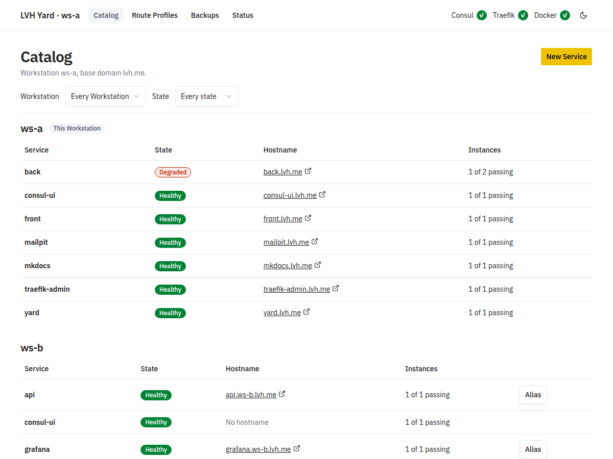

# LVH Yard

[](https://github.com/ppalazon/lvh-yard/actions/workflows/ci.yml)
[](LICENSE)

Reach any development service on your HomeLab by name, not by IP and port.

LVH Yard (Local Virtual Host Yard) gives each service that you run on your
computers a hostname such as `http://grafana.lvh.me`. It works for services on
your own computer and on every other computer in your Yard. You do not remember
ports, and you do not edit `/etc/hosts`.

How's that?, is it magic?. Well, no. It takes advantages of whatever public DNS
domain which points towards localhost `127.0.0.1` address. For example, any
request that you perform to `*.lvh.me` will point to your localhost, and that's
it. You can even create your custom wildcard DNS entry to your localhost.
However, there could be some problems for specific ISP or DNS servers because
they're block this kind of DNS.

<picture>
  <source media="(prefers-color-scheme: dark)" srcset="docs/site/assets/dashboard-catalog-dark.png">
  
</picture>

## How it works

- A **Workstation** is a computer that runs LVH Yard. It runs
  [Consul](https://developer.hashicorp.com/consul),
  [Traefik](https://doc.traefik.io/traefik/) and the LVH Yard dashboard, in
  Docker.
- A **Service** is a name for something that you want to reach, such as
  `grafana`. Its **Instances** are the host and port where it runs: a fixed
  address, or a Docker container that LVH Yard follows.
- When you **publish** a Service, Traefik on your Workstation sends requests
  for `grafana.lvh.me` to the Instances that pass their health checks.
- All the Workstations on one LAN form a **Yard**. They see each other's
  Services. With Yard Scope, a Service gets a hostname on every Workstation.

The trick is a wildcard domain that points to `127.0.0.1`. `lvh.me` is one. If
you do not trust a public domain, set your own wildcard domain as the Base
Domain of your Workstation.

## Demo

On `ws-a`, publish two Services. `front` runs on this computer. `mailpit` is a
Docker container, and LVH Yard follows it, whatever host port Docker gives it:

```sh
lvh-yard service create front
lvh-yard register static front --port 3000
lvh-yard publish front

lvh-yard service create mailpit
lvh-yard register container mailpit-1 --port 8025 --service mailpit
lvh-yard publish mailpit
```

Then `http://front.lvh.me` and `http://mailpit.lvh.me` work in your browser.
`lvh-yard catalog` shows every Service in the Yard, grouped by Workstation:

```text
ws-a (this Workstation)
  front          healthy    front.lvh.me          1 of 1 passing
  mailpit        healthy    mailpit.lvh.me        1 of 1 passing
ws-b
  grafana        healthy    grafana.ws-b.lvh.me   1 of 1 passing
```

`grafana` runs on `ws-b`, and `ws-a` reaches it at `grafana.ws-b.lvh.me`.

## Features

- A hostname for each Service, on one Workstation or on all of them.
- Several Instances for one Service. The Route uses only the Instances that
  pass their health checks, so you can test replicas in a production-like
  setup.
- Docker containers and Compose services follow their Service, whatever host
  port Docker gives them.
- Route Profiles add Traefik middlewares to a Route, such as basic auth, IP
  allow lists, headers and CORS
  ([Traefik middlewares](https://doc.traefik.io/traefik/reference/routing-configuration/http/middlewares/overview/)).
- A web dashboard and the `lvh-yard` command show the same things: state,
  Instances, Service Warnings and reachability tests.
- Backups of one Workstation's setup, as one YAML file, to restore or copy.
- One `lvh-yard` executable, with no Java. The dashboard runs as a Docker
  image.

## Install

You need Docker with Compose on every Workstation. The `lvh-yard` executable is
available for Linux (amd64, arm64) and macOS (arm64). Docker is the only
container runtime that LVH Yard supports. Podman is not supported.

Run the install script. It downloads the archive of your platform, checks it
against `SHA256SUMS`, and puts `lvh-yard` in `~/.local/bin`:

```sh
curl -fsSL https://lvhy.cc/install.sh | sh
```

To install by hand, or to set the version and the folder, read
[Installing the CLI](docs/user-guide.md#installing-the-cli).

## Quick start

```sh
lvh-yard ws init                             # writes ~/.config/lvh-yard
cd ~/.config/lvh-yard && docker compose up -d  # starts Consul, the dashboard and Traefik
lvh-yard status                                # checks that it all works
```

Open [yard.lvh.me](http://yard.lvh.me), the dashboard. To add a second
Workstation to your Yard, see
[Joining a Yard](docs/user-guide.md#joining-a-yard).

> [!WARNING] The dashboard has no login. Anyone who reaches it can change the
> Services of that Workstation and reach its containers through the Docker
> socket. By default it listens on `127.0.0.1` only. Read
> [SECURITY.md](SECURITY.md) before you open it to your LAN.

## Documentation

- [User guide](docs/user-guide.md): install and use LVH Yard.
- [Development](docs/development.md): build, test and release LVH Yard.
- [GLOSSARY.md](GLOSSARY.md): the words that LVH Yard uses.
- [Decisions](docs/adr/): why LVH Yard is built this way.
- [Contributing](CONTRIBUTING.md), [Code of Conduct](CODE_OF_CONDUCT.md) and
  [Support](SUPPORT.md).

## Versioning and releases

LVH Yard follows [Semantic Versioning](https://semver.org/). Before 1.0.0, any
minor release can change how it works. The version comes from the Git tag.
Pushing a tag such as `v0.1.0` builds the dashboard image, the `lvh-yard`
archives and `SHA256SUMS`. The notes of each
[GitHub release](https://github.com/ppalazon/lvh-yard/releases) list the
commits since the last release.

## AI-assisted development

This project was developed with assistance from AI coding tools.

The project maintainer is responsible for its architecture, implementation
decisions, code review, testing, and maintenance.

AI-generated contributions are reviewed before inclusion in the project.

## License

LVH Yard is licensed under the Apache License, Version 2.0. See the
[LICENSE](LICENSE) file for details.
