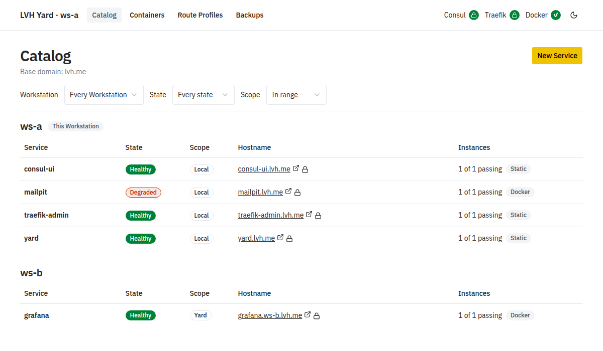
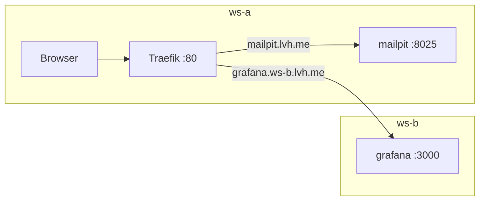

# LVH Yard

[](https://github.com/ppalazon/lvh-yard/actions/workflows/ci.yml)
[](LICENSE)

**Reach any dev, local or Docker service on your computer, HomeLab or LAN by name, not by IP and port.**

LVH (Local Virtual Host) Yard gives every service a hostname, such as `http://mailpit.lvh.me`, and you write no port. The service can be a local process, a Docker container, a Compose project or a program on another computer. Every computer in your Yard opens the same name. LVH Yard integrates Consul, Traefik and Docker for you.

<picture>
  <source media="(prefers-color-scheme: dark)" srcset="docs/landing/assets/dashboard-catalog-dark.png">
  
</picture>

## Requirements

- Docker with Compose on every Workstation. Docker is the only container runtime that LVH Yard supports. Podman is not supported.
- `lvh-yard` for Linux (amd64, arm64), macOS (arm64) or Windows 11 (x64). It needs no Java.
- On Windows 11: Docker Desktop with the WSL2 backend and host networking. The Windows Workstation supports IPv4 only, and the executable is not signed, so Windows may warn you. GitHub's CI tests the CLI on Windows Server. The maintainer tests Windows 11 with Docker Desktop by hand, see [Development](docs/development.md#windows-runtime-development). Read [Windows Workstation setup](docs/user-guide.md#windows-workstation-setup) before you start.

> [!WARNING]
> Use LVH Yard on a network that you trust. The dashboard has no login. Anyone who reaches it can change the Services of that Workstation and reach its containers through the Docker socket. By default it listens on `127.0.0.1` only. Read [SECURITY.md](SECURITY.md) before you open it to your LAN.

## How it works

A wildcard domain answers the same address for every name below it. For `lvh.me`, that address is `127.0.0.1`, your own computer. Traefik reads the hostname and sends the request to the right service. A domain that you own can answer any address, such as the LAN address of a Workstation.



- A **Workstation** is a computer that runs LVH Yard. It runs [Consul](https://developer.hashicorp.com/consul), [Traefik](https://doc.traefik.io/traefik/) and the LVH Yard dashboard, in Docker.
- A **Service** is a name for something that you want to reach, such as `mailpit`. Its **Instances** are the host and port where it runs: a fixed address, or a Docker container that LVH Yard follows.
- When you **publish** a Service, Traefik on your Workstation sends requests for `mailpit.lvh.me` to the Instances that pass their health checks.
- All the Workstations on one LAN form a **Yard**. Consul shares their Services, so they see each other's Services. With Yard Scope, a Service gets a hostname on every Workstation.

`lvh.me` belongs to a third party, and some routers and DNS servers block names that answer `127.0.0.1`. For daily work, use a wildcard domain that you own as the Base Domain of your Workstation. `l.lvhy.cc` is the domain of this project. [Pick your Base Domain](https://lvhy.cc/docs/start/pick-your-base-domain/) explains the choice.

## Quick start

This is a quick tutorial with the `traefik/whoami` container. The commands are the same on Linux, macOS and Windows, except for the install line.

**1. Install LVH Yard.** The script downloads the archive of your platform, checks it against `SHA256SUMS`, and puts `lvh-yard` in `~/.local/bin`.

```sh
# Linux or macOS
curl -fsSL https://lvhy.cc/install.sh | sh
```

```powershell
# Windows 11, in Windows PowerShell 5.1 or PowerShell 7. It needs no administrator rights.
Invoke-RestMethod https://lvhy.cc/install.ps1 | Invoke-Expression
```

To install by hand, or to set the version and the folder, read [Installing the CLI](docs/user-guide.md#installing-the-cli).

**2. Create a Workstation.** `ws init` asks two questions and writes the Workstation Folder: `~/.config/lvh-yard`, or `$env:LOCALAPPDATA\lvh-yard\workstation` on Windows.

```text
$ lvh-yard ws init
Workstation name (lowercase letters, digits and -) [laptop]: ws-a
Base Domain: lvh.me
$ lvh-yard ws compose start
$ lvh-yard status
LVH Yard on this Workstation: ok
```

**3. Run a container and give it a name.** Docker picks the host port, and you never write it.

```sh
docker run -d --name whoami -p 80 traefik/whoami
lvh-yard service create whoami
lvh-yard register container whoami --port 80
lvh-yard publish whoami
# Published whoami at whoami.lvh.me.
```

**4. Open it by name.** On Windows, run `curl.exe`.

```text
$ curl http://whoami.lvh.me
Hostname: 82ec38bd098d
```

LVH Yard also publishes three Services on its first start:

- [yard.lvh.me](http://yard.lvh.me): LVH Yard Dashboard
- [consul-ui.lvh.me](http://consul-ui.lvh.me): Consul UI.
- [traefik-admin.lvh.me](http://traefik-admin.lvh.me): Traefik Admin.

To add a second Workstation to your Yard, read [Create a Yard and join it](https://lvhy.cc/docs/recipes/reach/create-a-yard/).

## Features

- **A name instead of a port.** `lvh-yard publish mailpit` gives `mailpit.lvh.me`. [Your first Service](https://lvhy.cc/docs/start/first-service/)
- **Containers and Compose services follow their Service.** Bind once with `lvh-yard register compose demo/mailpit --port 8025`. The hostname stays when `docker compose up` gives a new port. [Stop chasing Compose ports](https://lvhy.cc/docs/recipes/name/compose-ports/)
- **Instance Priority.** Run your modified copy of a service first. When it stops, the container that you usually run answers again.
- **Health-checked Routes.** A Service can have many Instances. The Route uses only the ones that pass, so you can test replicas as in production.
- **One hostname per app.** Each app gets its own cookies, so `localhost:3000` no longer breaks cookies and OAuth callbacks. [Fix cookies and OAuth callbacks](https://lvhy.cc/docs/recipes/name/cookies-and-oauth/)
- **HTTPS in development.** `lvh-yard ws tls https create` signs a certificate with your Workstation CA. Trust that CA once. [Test HTTPS with your Workstation CA](https://lvhy.cc/docs/recipes/https/workstation-ca/)
- **Share with the Yard.** `lvh-yard publish mailpit --scope yard` gives a hostname on every Workstation of the Yard. [Show your work to a teammate](https://lvhy.cc/docs/recipes/reach/show-your-work/)
- **Route Profiles.** Add [Traefik middlewares](https://doc.traefik.io/traefik/reference/routing-configuration/http/middlewares/overview/) to a Route: basic auth, IP allow lists, headers and CORS.
- **A dashboard and a CLI.** Both show the state, the Instances, the Service Warnings and the reachability tests of every Service.
- **Backups.** Export the setup of a Workstation to one YAML file. Import it on the same Workstation or on another one.
- **One executable.** `lvh-yard` needs no Java. The dashboard runs as a Docker image.

## Documentation

- [Guide](https://lvhy.cc/docs/): recipes and steps for the common tasks.
- [User guide](docs/user-guide.md): the full reference for install and use.
- [Development](docs/development.md): build, test and release LVH Yard.
- [GLOSSARY.md](GLOSSARY.md): the words that LVH Yard uses.
- [Decisions](docs/adr/): why LVH Yard is built this way.
- [Contributing](CONTRIBUTING.md), [Code of Conduct](CODE_OF_CONDUCT.md) and
  [Support](SUPPORT.md).

## Versioning and releases

LVH Yard follows [Semantic Versioning](https://semver.org/). Before 1.0.0, any
minor release can change how it works. The version comes from the Git tag.
Pushing a tag such as `v0.1.0` builds the dashboard image, the `lvh-yard`
archives and `SHA256SUMS`. The notes of each
[GitHub release](https://github.com/ppalazon/lvh-yard/releases) list the
commits since the last release.

## AI-assisted development

This project was developed with assistance from AI coding tools.

The project maintainer is responsible for its architecture, implementation
decisions, code review, testing, and maintenance.

AI-generated contributions are reviewed before inclusion in the project.

## License

LVH Yard is licensed under the Apache License, Version 2.0. See the
[LICENSE](LICENSE) file for details.
