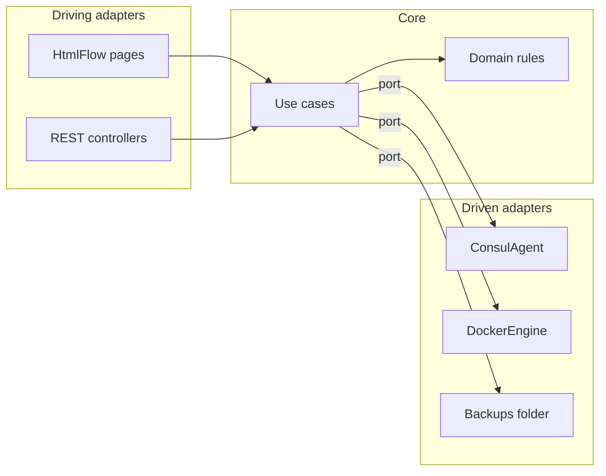
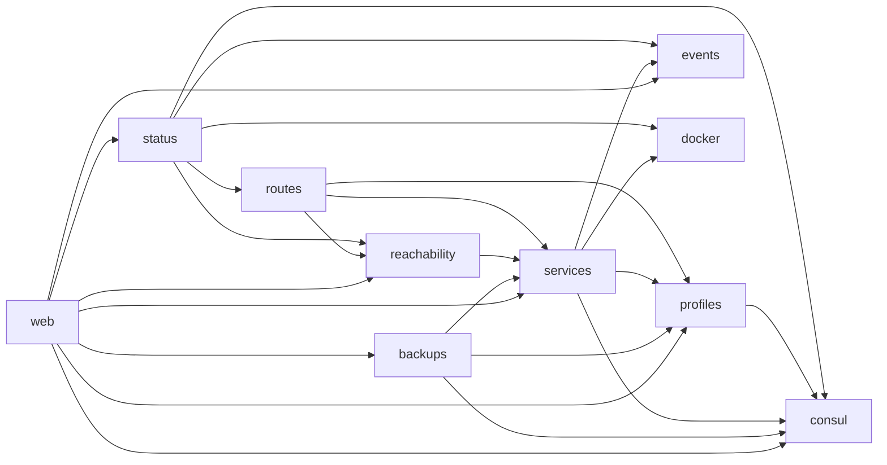
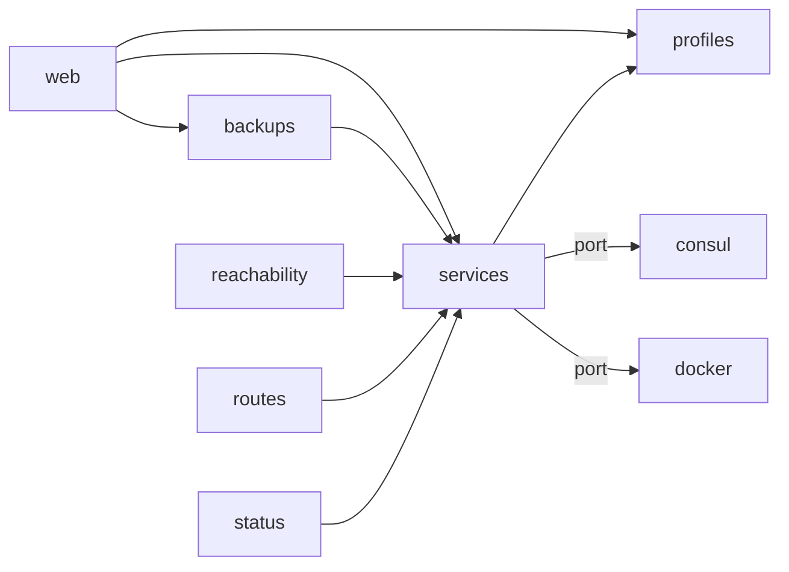
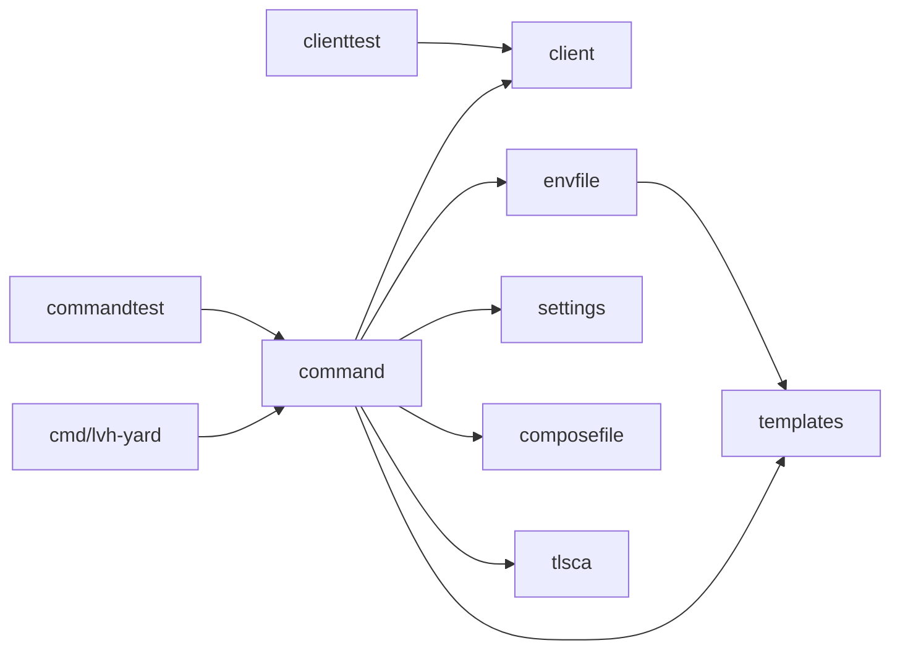

# Design

This page is for people who work on LVH Yard itself. It shows how the code is
built today, what the checks found, and where the code should go. For the words
of LVH Yard, read [GLOSSARY.md](../GLOSSARY.md). For the commands, read
[development.md](development.md).

Numbers are from 2026-11-13. They show the start, not a rule.

## Words used here

| Word            | Meaning                                                                                        |
| --------------- | ---------------------------------------------------------------------------------------------- |
| Domain core     | Rules of LVH Yard. It knows no web, no Consul, no Docker.                                      |
| Use case        | One thing a person asks for, such as "register an Instance". It calls the rules and the ports. |
| Port            | An interface that the core owns. It says what the core needs from outside.                     |
| Driving adapter | Code that calls the core: web pages, REST controllers, CLI commands.                           |
| Driven adapter  | Code that the core calls through a port: `ConsulAgent`, `DockerEngine`.                        |

These words are about the code. `GLOSSARY.md` does not hold them.

Every arrow points to the core, or goes out through a port that the core owns.

## SOLID, with this repo

| Principle             | Rule                                                      | Example here                                                                                                                | Fix                                                                                                                                               |
| --------------------- | --------------------------------------------------------- | --------------------------------------------------------------------------------------------------------------------------- | ------------------------------------------------------------------------------------------------------------------------------------------------- |
| Single responsibility | A class has one reason to change.                         | `Registrations` (587 lines) checked input, parsed text and wrote to Consul.                                                 | Done: `InstanceRules` has the checks and no Spring. `Registrations` (309 lines) keeps the Consul writes.                                          |
| Open/closed           | A new kind needs a new class, not an edit in many places. | `SourceKind` is a `switch` key in `InstanceSourcesCard` (lines 178, 201, 268, 286, 461) and `BackupExport:79`.              | Put the behavior on the kind.                                                                                                                     |
| Liskov substitution   | A subtype works wherever its parent works.                | Not checked. No tool covers it.                                                                                             | None.                                                                                                                                             |
| Interface segregation | A class depends only on the methods it uses.              | `Consul` has 15 methods, and nine classes used it whole.                                                                    | Done: five roles, `ConsulKv`, `ConsulCatalog`, `ConsulFederation`, `ConsulRegistrations` and `ConsulWatching`. Each class holds the role it uses. |
| Dependency inversion  | The core owns the interface. The adapter follows it.      | `YardReader` imported `org.springframework.web.client.HttpServerErrorException`. `Consul` holds `@JsonProperty` wire types. | `ConsulAgent` now throws `ConsulException`, so no class outside `consul` imports the Spring web client. The wire types are next.                  |

## Dashboard (Java)

### Today

The package graph had three cycles at first: `services`↔`profiles`,
`services`↔`reachability` and the base package↔`web`. They are gone, and
`ArchitectureTest` fails on a new one. What changed:

- `OutOfRange` and `TraefikSettings` moved to the base package, next to
  `Workstation`. They are settings that every package reads.
- `Problems` moved to `web`, where `ErrorPage` is.
- `ProfileUsage` is an interface of `profiles`. `Publications` implements it, so
  `RouteProfileEditor` no longer imports `services`.
- `ReachabilityController` holds the two reachability endpoints, in
  `reachability`. `ServicesController` and `WorkstationServicesController` no
  longer import `reachability`. The OpenAPI tag of both endpoints is now
  `reachability-controller`.
- `ServiceViews` builds the HTTP and HTTPS addresses of a Service, so
  `TraefikSettings` no longer imports `Service`.

- `services` is the hub: domain rules, Spring beans, four REST controllers and
  JSON DTOs in one package (about 60 files).
- `consul` and `docker` are real ports, with a fake and a contract test each
  ([ADR 0008](adr/0008-unit-component-and-integration-tests.md)). `events` is
  also a leaf.
- No port exists for Traefik (`TraefikStatus` and `ReachabilityTester` open
  their own connections), for files (`BackupsFolder` uses `Files.*`) or for the
  clock (`Instant.now()` in nine classes).
- No use-case layer exists. `PagesController` and the REST controllers call
  `Registrations`, `Publications`, `Aliases` and `YardReader` and catch their
  exceptions.

### Findings

| Class               | Size                        | PMD                                                 | Problem                                                                                    |
| ------------------- | --------------------------- | --------------------------------------------------- | ------------------------------------------------------------------------------------------ |
| `Registrations`     | 587 lines at first, 309 now | God class, total cyclomatic complexity 105 at first | Split: `InstanceRules` (301 lines, no Spring) has the input rules. The Consul writes stay. |
| `YardReader`        | 431 lines                   | God class, coupling 47 (limit 20)                   | Reads Consul, runs a circuit breaker, builds hostnames, maps entries and parses durations. |
| `ImportPlanner`     | 505 lines                   | God class, coupling 34                              | Ten constructor dependencies.                                                              |
| `ContainerBindings` | 390 lines                   | God class, coupling 25                              | Checks, Consul writes and Docker sync together.                                            |
| `PagesController`   | 527 lines                   | Total cyclomatic complexity 85, 10 imports too many | Ten constructor dependencies and about 30 handlers.                                        |
| `BackupsPage`       | 636 lines                   | God class                                           | One view class with 48 branches.                                                           |

SpotBugs found 80 problems and PMD found 150 when I first ran them. Most are
noise or style:

| Finding                                           | Count | Verdict                                                                                                                                                                                    |
| ------------------------------------------------- | ----- | ------------------------------------------------------------------------------------------------------------------------------------------------------------------------------------------ |
| SpotBugs `EI_EXPOSE_REP` and `EI_EXPOSE_REP2`     | 75    | A record or class holds a list or map that the caller can change. Nothing changes them after the dashboard builds them, so `spotbugs-exclude.xml` skips both patterns.                     |
| SpotBugs `NP_NULL_ON_SOME_PATH_FROM_RETURN_VALUE` | 3     | Fixed in `ConsulAgent` and `BackupsPagesController`. `BackupsFolder:93` is a false alarm: a child path always has a file name. `spotbugs-exclude.xml` lists it.                            |
| SpotBugs and PMD, unused private method           | 3     | `Registrations.notATcpPort` and `PagesController.notCreated` are deleted. `mise run check` fails on a new one.                                                                             |
| PMD `PreserveStackTrace`                          | 6     | Not a fault. Each one turns a low-level error into a domain exception whose message already holds the cause text, or unwraps `ExecutionException` on purpose. The rule is not in the gate. |
| PMD `CompareObjectsWithEquals`                    | 9     | Not a fault. Each `==` compares a thread or an object by identity on purpose. The rule is not in the gate.                                                                                 |
| PMD `TooManyMethods`                              | 22    | Follows from the god classes.                                                                                                                                                              |

### Mutation tests

PIT changes the code and runs the unit tests only (`*Test`, not
`*ComponentTest`). A mutant that no test fails on survives. The component tests
cover the HTTP path, so these numbers are the unit tests alone. The first
column is the first run, the second is after the new tests of `Registrations`
and `RouteBuilder`:

| Class                               | Mutants | Killed at first | Killed now | Survived now |
| ----------------------------------- | ------- | --------------- | ---------- | ------------ |
| `Registrations` and `InstanceRules` | 137     | 23 (17%)        | 137 (99%)  | 1            |
| `BackupFormat`                      | 125     | 101 (81%)       | 101 (81%)  | 7            |
| `Routing`                           | 34      | 29 (85%)        | 29 (85%)   | 0            |
| `RouteBuilder`                      | 28      | 16 (57%)        | 28 (100%)  | 0            |
| All classes                         | 325     | 169 (52%)       | 295 (91%)  | 8            |

`dashboard/pom.xml` sets `mutationThreshold` to 90, so `mise run quality` fails
when the score drops. The one survivor of `InstanceRules` is `parseMeta` returning
an empty map for no text, which no caller can tell from a new empty map. The 17
mutants of `BackupFormat` and 5 of `Routing` that no unit test reaches are next.

### Target

Ports and adapters inside each feature package. The packages keep their names.

- The `Consul` port is for testing and isolation. Consul stays the one
  registry ([ADR 0001](adr/0001-one-consul-datacenter-per-workstation.md) and
  [ADR 0004](adr/0004-route-profiles-travel-through-consul-kv.md)).
- `ConsulAgent` throws `ConsulException`, with `ConsulUnreachableException`
  (no answer in time) and `ConsulServerException` (a 5xx) for the two cases that
  mean a datacenter cannot be read now. Done.
- `Consul` is split by role into five interfaces, and `ArchitectureTest` fails on a
  class outside `consul` that holds all of `Consul`. Done.
- The wire types (Consul's JSON field names) are private to `ConsulAgent`, and
  the types of the port have no Jackson annotation. Done.
- Pure rules import no Spring: `Routing`, `ServiceWarning`, `OutOfRange`, the
  input checks.
- Use cases may keep `@Component`.
- The code has no package cycles, and `ArchitectureTest` checks it.

`ArchitectureTest` checks these rules, and no class outside `consul` may use the
Spring web client. A rule that is frozen has its known violations in
`dashboard/src/test/resources/archunit_store`, and fails only on a new one. One
rule is frozen: Spring in the pure rules (`OutOfRange`). When a violation is
fixed, ArchUnit drops it from the store.

## CLI (Go)

### Today

- `command` had 4,307 lines in 34 flat files. It holds cobra commands, output,
  `docker compose` calls and prompts. The pure logic moved out into four
  packages that read and write no file and print nothing:
  - `envfile`: the text of a `.env` file.
  - `settings`: the name of each Workstation setting and what it accepts, with one
    rule for each in a table, in place of one switch.
  - `composefile`: the image values of a `compose.yaml`, and their replacement.
  - `tlsca`: the Yard CA, the Consul and Traefik certificates, the Client
    Certificates, and the checks of a certificate.
    Each has its own tests. For `settings` and `composefile`, a temporary test
    compared the new code with the old for many inputs, and the answers were the
    same.
- `client` is clean. It imports no other package of the CLI.
- `command.Process` is the only interface. It has 7 methods and mixes
  environment, input, terminal, LAN address, editor, `exec` and `id`.
- Each command called `client.New(options.DashboardAddress())` (24 call sites),
  so each test started its own `httptest` server. Now `command.Dashboard` is an
  interface of the 26 methods that the commands use. `Options.Dashboard` builds
  it, and `client.Client` is the default. `commandtest.Harness.Dashboard` sets a
  fake. `TestStatus` uses one. The other command tests still use `httptest`,
  which also checks the JSON, and they can move one at a time.
- Leaks: `ws_yard_peers.go:readWANMembers` makes its own HTTP client to Consul.
  `dashboard.go` reads `.env` with `os.ReadFile`.

### Findings

golangci-lint first found 564 problems, 401 of them outside the tests. The table
is that first run.

| Linter            | Not in tests | What                                                                                                                                                                   |
| ----------------- | ------------ | ---------------------------------------------------------------------------------------------------------------------------------------------------------------------- |
| errcheck          | 164          | Unchecked `fmt.Fprint*` to a writer (159), `Close`, `Remove`, `Write`.                                                                                                 |
| revive            | 162          | 25 capitalized error strings, 23 unused parameters, missing comments.                                                                                                  |
| staticcheck       | 36           | 33 of them are ST1005, capitalized error strings.                                                                                                                      |
| gocyclo (over 15) | 18           | Worst: `NewRemove` 40, `init.create` 38, `upgradeInit` 33, `checkWSSetting` 31, `newWSTLSIssueUser` 30, `newWSTLSIssueRoles` 29, `newWSYardShare` 27, `NewCatalog` 26. |
| gosec             | 16           | 11 file reads from a variable path, 3 `exec` calls.                                                                                                                    |
| modernize         | 4            | `errors.AsType`, `SplitSeq`, `slices.Contains`.                                                                                                                        |
| errorlint         | 1            | `root.go:84` compares errors with `!=`.                                                                                                                                |

Capitalized error strings are the style of the CLI messages, so `cli/.golangci.yml`
turns off ST1005 and the revive rule for them. It also skips unchecked
`fmt.Fprint*` writes. `errcheck`, `errorlint`, `modernize` and the other
small findings are fixed, and `mise run check` fails on a new one. The
complexity, `gosec` and revive findings remain, and `mise run quality:go`
lists them.

### Target

- The dashboard interface is in `command`, next to where it is used, and is
  injected through `Options`, as `Process` is. It is one interface, not one for
  each command, so it is wide. A test fake embeds it and gives only the methods
  that its command calls. Split it by command if a fake gets in the way.
- Move pure logic out of the cobra closures into packages. Done for the four
  above, and `checkWSSetting` (31) and `composeImages` (20) left the gocyclo
  list. The worst closures remain: `NewRemove` 40, `init.create` 38,
  `newWSTLSIssueRoles` 29, `upgradeInit` 27 and `newWSYardShare` 27. They mostly
  orchestrate prompts, files and output, so the next step is smaller functions in
  `command`, not more packages.
- No port for the filesystem or the clock. `t.TempDir()` is enough.
- Split `Process` only if the client change shows the need.

## Quality tools

`mise run quality` runs all of them. `docs/development.md` has the details.

| Tool          | Checks             | Runs in `mise run check`                                             |
| ------------- | ------------------ | -------------------------------------------------------------------- |
| golangci-lint | Go code            | Yes, the linters with no finding today. The rest are in `quality:go` |
| SpotBugs, PMD | Java code          | Yes, SpotBugs with a skip list, and PMD for unused code              |
| PIT           | Java unit tests    | No                                                                   |
| ArchUnit      | Java package rules | Yes, as `ArchitectureTest`                                           |

### Mutation tests of the CLI

`mise run quality` does not run them. Go has no standard tool, and two
community tools were tried on `internal/command`:

- **gremlins** does not work here. It reports 800 mutants killed and none
  alive. Applied by hand, 4 of 36 sampled mutants that it called killed
  survive, and string `+` mutants that cannot compile count as killed. The
  cause is probably the temporary copy of the module: tests read
  `../../../config`. This is not confirmed.
- **go-mutesting** works. It mutates the file in place and runs the package
  tests. On `ws_settings.go` it found 104 mutants and 29 survivors (score
  0.72) in 68 seconds. Some survivors are unchecked output text, such as
  `Saved .env. Apply the settings:`. The whole package would take about half an
  hour, so run it on one file at a time:
  `go install github.com/avito-tech/go-mutesting/cmd/go-mutesting@latest`, then
  `go-mutesting --exec-timeout=60 internal/command/<file>.go` from `cli/`.
