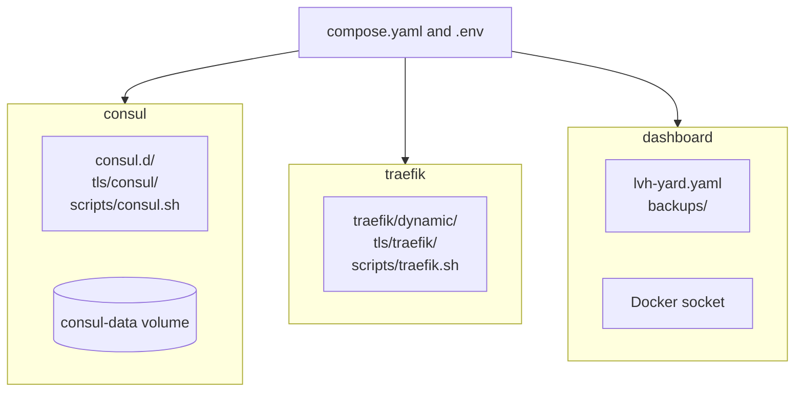
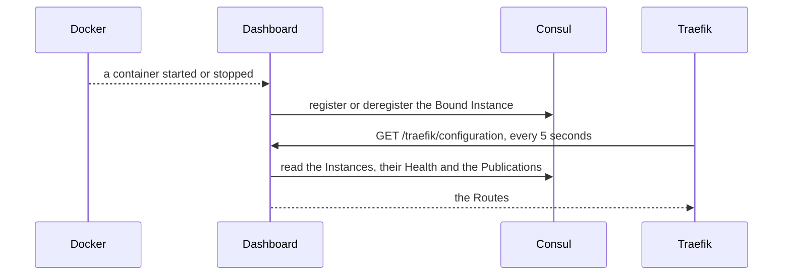

# How the Workstation Folder wires Consul, Traefik and the dashboard

A Workstation is three containers and one folder. This page shows how the files of the folder configure the containers, and why LVH Yard chose each wiring. You need none of it to use LVH Yard.

## The three containers and their files

Docker Compose starts `consul`, `traefik` and `dashboard` from `compose.yaml`. The file `.env` gives the values. Each container reads its own files.



Consul keeps its data in the Docker volume `consul-data`, not in the folder. The dashboard reads the Docker socket to follow the containers of the Workstation.

## How a request gets its Route

Traefik does not read Consul. It asks the dashboard for its Routes. The dashboard builds them from Consul and Docker.



The `traefik` container starts with the flag `--providers.http.endpoint=http://<dashboard>:7780/traefik/configuration`. While the dashboard is down, Traefik keeps its last Routes and tries again.

LVH Yard does not use `traefik.*` tags on the Instances and the Consul Catalog provider of Traefik. Two reasons:

- A Publication belongs to a Service, and a tag belongs to one Instance. With tags, a new Instance would start unpublished, and two Instances of one Service could disagree.
- Each Workstation is its own Consul datacenter, and the Consul Catalog provider reads one datacenter. The dashboard reads every datacenter, so one Traefik sees the whole Yard.

Another tool can register an Instance in Consul too. See [Register a service in Consul yourself](register-in-consul.md).

## Host networking and the ports

All three containers use `network_mode: host`. Traefik then reaches an Instance where it is: a process on the loopback of the Workstation, a container on any Docker network, or an address on the LAN. In a Compose network, `127.0.0.1` would be the container itself, and a Static Instance on loopback would get no Route.

| Process             | Listens on                    | Default port          | Faces the LAN                                     |
| ------------------- | ----------------------------- | --------------------- | ------------------------------------------------- |
| Consul server RPC   | `YARD_BIND_ADDRESS`           | 8300                  | Yes, after `ws yard init` or `ws yard join`       |
| Consul WAN gossip   | `YARD_BIND_ADDRESS`           | 8302, TCP and UDP     | Yes, after `ws yard init` or `ws yard join`       |
| Consul LAN gossip   | `YARD_BIND_ADDRESS`           | 8301                  | Other Workstations do not need it                 |
| Consul HTTP API     | `127.0.0.1`                   | 8500                  | No                                                |
| Consul DNS and gRPC | `127.0.0.1`                   | 8600 and 8503         | No                                                |
| Traefik, HTTP       | `YARD_TRAEFIK_BIND_ADDRESS`   | 80                    | Only if you set another address                   |
| Traefik, HTTPS      | `YARD_TRAEFIK_BIND_ADDRESS`   | 443, when HTTPS is on | Only if you set another address                   |
| Traefik admin       | `127.0.0.1`                   | 7781                  | No                                                |
| Dashboard           | `YARD_DASHBOARD_BIND_ADDRESS` | 7780                  | Only if you set another address. It has no login. |

`YARD_BIND_ADDRESS` is `127.0.0.1` after `ws init`. The ports of Consul that face the LAN open only when `ws yard init` or `ws yard join` sets the LAN address.

## The Consul configuration

The script `scripts/consul.sh` starts Consul. `compose.yaml` gives it the ports as flags, and the script adds the bind address, the Peers and the Gossip Key from `.env`.

- **One datacenter for each Workstation.** The flags `-datacenter` and `-node` use the name of the Workstation, and `bootstrap_expect = 1` makes every Workstation its own server. Workstations come and go, so none of them may depend on another one being on. With one Raft cluster, two Workstations would need both to be on to change anything.
- **WAN federation.** For each address in `YARD_PEERS`, the script adds `-retry-join-wan`. This joins the datacenters.
- **The Gossip Key.** The script passes `YARD_GOSSIP_KEY` as `-encrypt`. The file `00-lvh-yard.hcl` sets `disable_keyring_file = true`, so Consul reads the key from `.env` at each start. Without it, Consul keeps its first key and ignores a new one.
- **TLS on the RPC only.** After `ws yard init` or `ws yard join`, the file `10-tls.hcl` makes the RPC between Workstations require TLS in both directions. The HTTP API stays plain and local.

## The Traefik configuration

Traefik has no `traefik.yaml`. It takes its install options from one source only: a file, flags or environment variables. A file would make it ignore the flags that carry values of `.env`, such as the bind addresses and the ports.

- **Fixed flags** in `compose.yaml`:
    - the entry point `web` at `YARD_TRAEFIK_BIND_ADDRESS:YARD_HTTP_PORT`
    - the admin entry point `traefik` at `127.0.0.1:7781`, and the ping
    - the file provider of `traefik/dynamic/`
    - the HTTP provider, with a poll of 5 seconds
- **Flags that `scripts/traefik.sh` adds** from `.env`: the HTTPS entry point `websecure`, when `YARD_HTTPS_PORT` has a value, and the endpoint of the HTTP provider. For a dashboard on `0.0.0.0`, the endpoint uses `127.0.0.1`.
- **Files** in `traefik/dynamic/`: `10-tls.yaml` and `11-client-auth.yaml` hold the TLS options. The certificates are in `tls/traefik/`.

The admin page and the ping use their own entry point, always on loopback. They answer while the dashboard is down.

## Who owns which file

LVH Yard owns the files that it generates, and their names say so. Each one starts with a line "Generated, do not edit". LVH Yard owns the scripts too, because `ws compose update` writes them again. Consul and Traefik read their folders in name order, so your files come after them.

| File                                                                 | Owner    | `ws compose update`                          |
| -------------------------------------------------------------------- | -------- | -------------------------------------------- |
| `compose.yaml`                                                       | You      | Changes only the image lines                 |
| `.env`, `lvh-yard.yaml`                                              | You      | Leaves them                                  |
| `consul.d/00-lvh-yard.hcl`, `consul.d/10-tls.hcl`                    | LVH Yard | Writes them again                            |
| `traefik/dynamic/10-tls.yaml`, `traefik/dynamic/11-client-auth.yaml` | LVH Yard | Writes them again, for the parts that are on |
| `scripts/consul.sh`, `scripts/traefik.sh`                            | LVH Yard | Writes them again                            |

A change by hand to a file that LVH Yard owns is lost at the next upgrade. To keep a change, put it in a file of your own, or copy the script and point `compose.yaml` at the copy.

## Run LVH Yard without `lvh-yard ws init`

`lvh-yard ws init` only writes files. You can write them yourself and start Compose.

1. Make the folder and the folders in it, with mode 700 for folders and 600 for files.

    ```text
    compose.yaml
    .env
    lvh-yard.yaml
    consul.d/00-lvh-yard.hcl
    scripts/consul.sh
    scripts/traefik.sh
    tls/consul/
    tls/traefik/
    traefik/dynamic/
    backups/
    ```

    The files `compose.yaml`, `00-lvh-yard.hcl`, `consul.sh`, `traefik.sh` and `lvh-yard.yaml` are in the folder `config/` of the repository.

2. Write `.env`. Compose needs `YARD_WORKSTATION`, `YARD_GOSSIP_KEY`, `YARD_UID` and `YARD_GID`. The dashboard needs the group of the Docker socket. Set `YARD_BIND_ADDRESS` to `127.0.0.1`. When it is empty, Consul listens on the address of the default route.

    ```ini
    YARD_WORKSTATION=ws-a
    YARD_GOSSIP_KEY=<the output of: openssl rand -base64 32>
    YARD_BIND_ADDRESS=127.0.0.1
    YARD_BASE_DOMAIN=lvh.me
    YARD_UID=<id -u>
    YARD_GID=<id -g>
    YARD_DOCKER_GID=<stat -c %g /var/run/docker.sock>
    COMPOSE_PROFILES=dashboard,traefik
    ```

3. Start the containers, and check them.

    ```sh
    docker compose up -d
    lvh-yard status
    ```

What you lose: the commented `.env`, the Gossip Key that `ws init` makes, the modes of the files and the checks of the commands. Compose names the project after the folder, so give each Workstation its own folder name.

## Run on a public server (not tested)

!!! warning "The dashboard has no login. You can add one."

    Publish the `yard` Service with a Route Profile that has basic auth. Keep the dashboard on `127.0.0.1`. Let only Traefik listen on the address that others reach, and serve it over HTTPS. Use a domain that you own and that points to that address: `lvh.me` and `l.lvhy.cc` point to `127.0.0.1`. Anything that runs on the Workstation still reaches the dashboard without a password. The maintainer has not tested a public server.

Read [SECURITY.md](https://github.com/ppalazon/lvh-yard/blob/main/SECURITY.md) first. These facts hold for the reference setup:

- After the first setup, `yard` is an ordinary Service, so a Route Profile applies to it.
- `YARD_DASHBOARD_BIND_ADDRESS=0.0.0.0` bypasses the Route and its password.
- A Yard Route to `yard` does not work for other Workstations. Its Instance is on loopback, and they mark it as an Out-of-range Instance.
- Consul ACLs are off. The dashboard and Traefik listen on `127.0.0.1` unless `.env` says otherwise.
