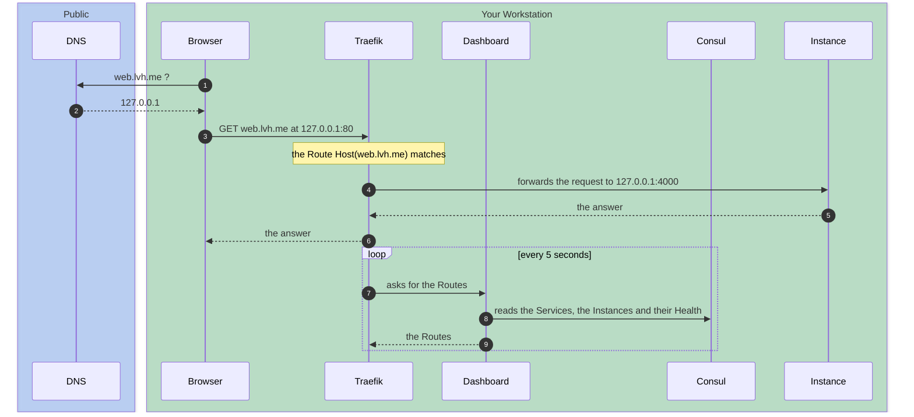

# How a request reaches your Service

A request takes four steps. DNS gives the address of Traefik. Traefik matches the hostname to a Route. The Route names an Instance. The Instance answers.



## The four steps

1. **DNS.** A wildcard DNS answers `127.0.0.1` for every name below the Base Domain. The browser connects to your own computer. See [Pick your Base Domain](../start/pick-your-base-domain.md).
2. **Traefik.** Traefik is the reverse proxy that listens on ports 80 and 443. It reads the hostname of each request.
3. **The Route.** A Route is a rule such as ``Host(`web.lvh.me`)``, with the Instances that pass their health checks. A Publication builds it, so a Service that you unpublish has no Route.
4. **The Instance.** An Instance is a process at a host and a port, a Docker container that LVH Yard follows, or an Instance of a Service on another Workstation. Traefik calls it where it runs: on loopback, on a Docker network or on the LAN.

## Where the setup lives

- **The Workstation Folder** holds the files of the Workstation. `.env` has the settings, `compose.yaml` has the three containers, and `lvh-yard.yaml` has the settings of the dashboard. `tls/` holds the certificates, and `backups/` holds the Backups. `consul.d/`, `traefik/` and `scripts/` hold files of Consul and Traefik that LVH Yard writes.
- **Consul** is the registry. It holds the Services, their Publications, the Route Profiles, the Instances and the Health of each Instance. A Workstation has its own Consul, and the Consuls of a Yard share their Services.
- **The dashboard** reads Consul and Docker, and it gives Traefik the Routes. Each Workstation runs its own dashboard. The CLI and the pages of the dashboard change the same setup.
- **Traefik** keeps its last Routes when the dashboard stops. The Routes then stay as they were, and new Services get no hostname until the dashboard runs again.

Consul, Traefik and the dashboard run in Docker, on the network of the computer. That is how Traefik reaches a process on loopback. [How the Workstation Folder wires Consul, Traefik and the dashboard](../advanced/compose-consul-traefik.md) has the details.

## See it yourself

The dashboard gives Traefik its Routes at `/traefik/configuration`. This is the Route of `web`, shortened and formatted:

```sh
curl -s http://127.0.0.1:7780/traefik/configuration
```

```json
{
  "routers": {
    "web": {
      "rule": "Host(`web.lvh.me`)",
      "entryPoints": ["web"],
      "service": "web"
    }
  },
  "services": {
    "web": {
      "loadBalancer": {
        "servers": [{ "url": "http://127.0.0.1:4000" }]
      }
    }
  }
}
```

Consul holds one record and one Publication for each Service. This lists the keys:

```sh
curl -s "http://127.0.0.1:8500/v1/kv/lvh-yard/?keys"
```

```text
["lvh-yard/first-setup","lvh-yard/publications/consul-ui","lvh-yard/publications/traefik-admin","lvh-yard/publications/web","lvh-yard/publications/yard","lvh-yard/services/consul-ui","lvh-yard/services/traefik-admin","lvh-yard/services/web","lvh-yard/services/yard"]
```
