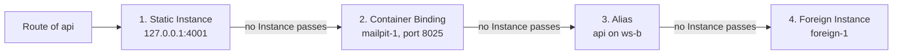

# Instance Sources and Priority

A Service gets its Instances from Instance Sources. Instance Priority puts the sources in an order. The Route uses the first source that has a passing Instance.

| Instance Source   | You add it with                                      | It gives                          |
| ----------------- | ---------------------------------------------------- | --------------------------------- |
| Static Instance   | `lvh-yard register static`                           | One process at a host and a port  |
| Container Binding | `lvh-yard register container` and `register compose` | The running containers that match |
| Alias             | `lvh-yard alias add`                                 | The Instances of a Remote Service |
| Foreign Instance  | Another tool, straight in Consul                     | One Instance                      |



## The order

- The Route uses only the first source that has an Instance with a passing check. It load balances the requests across all the passing Instances of that source. For example, it balances across the containers of a scaled Compose service.
- A new source goes to the end of the order. A Foreign Instance that appears goes to the end too.
- An edited Static Instance or Container Binding keeps its place. A removed source leaves the order. If you add it again, it goes to the end.
- If no Instance passes, the Route does not stop. It load balances the requests across every Instance in range. A check can fail while the app still answers. If the Instance requested are down, the hostname answers `502 Bad Gateway`. See [Find and fix a bad Route](../recipes/fix/bad-route.md).
- An Alias works only on the Home Workstation. Other Workstations skip it and use the next source.

## Read and change the order

```sh
lvh-yard priority api
```

```text
Instance Priority of api: on. The Route uses the first Instance Source with a passing Instance.
  1. 80b9e043-aa40-4867-8be4-21bd73c98b5f  Static Instance 127.0.0.1:4001  (in use)
  2. mailpit-1:8025  Container Binding to container mailpit-1, port 8025
  3. ws-b/api  Alias to api on ws-b
  4. foreign-1  Foreign Instance 127.0.0.1:4003
```

`(in use)` marks the source of the Route. Give the IDs to put sources first. The other sources follow in their order:

```sh
lvh-yard priority api ws-b/api
```

`--off` makes the Route a load balancer across every passing Instance of every source. `--on` brings the order back. The order stays while it is off.

```sh
lvh-yard priority api --off
lvh-yard priority api --on
```

In the dashboard, the `Instance Sources` card of the Service page shows the order. The `Instance Priority` switch turns it on and off, and the arrows at the right of a source move it. A green `In use` badge marks the source of the Route.

## Stop the sources, one by one

Stop the first source. The Route moves to the next one that passes. After each stop, `lvh-yard priority api` marks the new source. These are the lines with `(in use)`:

```text
  2. mailpit-1:8025  Container Binding to container mailpit-1, port 8025  (in use)
  3. ws-b/api  Alias to api on ws-b  (in use)
  4. foreign-1  Foreign Instance 127.0.0.1:4003  (in use)
```

The catalog names the kind of source in brackets. It also shows `degraded` while a source is down:

```sh
lvh-yard catalog
```

```text
  api            degraded  local  api.lvh.me            1/1  [docker]
  api            degraded  local  api.lvh.me            1/2  [alias]
  api            degraded   local  api.lvh.me            1/1  [foreign]
```

When no source has a passing Instance, the Service is `unhealthy` and the hostname answers `502`:

```text
  api            unhealthy  local  api.lvh.me            0/2  [static] [alias] [foreign]
```

With the Instance Priority off, the catalog lists every kind that gives the Route an Instance:

```text
  api            healthy  local  api.lvh.me            3/3  [static] [docker] [alias] [foreign]
```

## Where the recipes use it

- [Put your process before the container](../recipes/choose/instance-priority.md): a Static Instance before a Container Binding.
- [Develop one service, keep the rest in Docker](../recipes/name/host-process-and-compose.md): the same order for a Compose stack.
- [Test replicas and failover](../recipes/choose/replicas-and-failover.md): two Static Instances, with the Instance Priority off.
- [Swap a backend with an Alias](../recipes/choose/swap-with-an-alias.md): an Alias before a Static Instance.
- [Register a service in Consul directly](../advanced/register-in-consul.md): a Foreign Instance.
