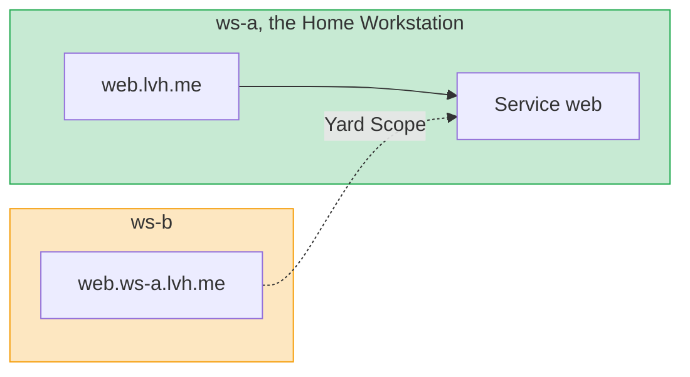

# Scope

The Scope of a Publication decides who gets a hostname for the Service. It does not decide who can connect.

| Scope | Hostname on the Home Workstation | Hostname on the other Workstations |
| ----- | -------------------------------- | ---------------------------------- |
| Local | `web.lvh.me`                     | none                               |
| Yard  | `web.lvh.me`                     | `web.ws-a.lvh.me`                  |



A new Publication has Local Scope. A hostname on another Workstation has the name of the Home Workstation, so two coworkers can both run a Service `api`. An [Alias](../recipes/choose/swap-with-an-alias.md) gives a Remote Service a short name on one Workstation. HTTPS needs a certificate name for each Workstation, because a wildcard covers one label: `*.lvh.me` does not cover `web.ws-a.lvh.me`. See [Test HTTPS with your Workstation CA](../recipes/https/workstation-ca.md).

## Change the Scope

On the Home Workstation, publish again with `--scope`. Without `--scope`, the Scope does not change.

```sh
lvh-yard publish web --scope yard
```

```text
Published web at web.lvh.me.
  Scope: Yard
  Other Workstations: web.ws-a.<base-domain>
```

In the dashboard, the switch `Share with the Yard` on the page of the Service does the same. A Remote Service has no switch. Only its Home Workstation changes it.

## What another Workstation sees

On `ws-b`, a Service with Local Scope has no Route. The catalog lists no Service of `ws-a`:

```text
ws-a: no Services
```

`--scope every` shows the Services that `ws-b` has no Route to. They have no hostname:

```sh
lvh-yard catalog --scope every
```

```text
ws-a
  consul-ui      healthy  local                        1/1
  lan            healthy  local                        1/1
  traefik-admin  healthy  local                        1/1
  web            healthy  local                        1/1
  yard           healthy  local                        1/1
```

With Yard Scope, the catalog of `ws-b` lists the hostname and the kind of Instance:

```text
ws-a
  lan            healthy  yard   lan.ws-a.lvh.me       1/1  [static]
```

## Scope does not protect the port

!!! warning "Scope decides who gets a hostname, not who can connect"

    Local Scope keeps the hostname off the other Workstations. It does not close the port of the Instance. An app that listens on every address answers on the LAN address, whatever the Scope is. An app that listens on `127.0.0.1` does not. A Docker port that you publish without an address listens on every address. Yard Scope does not limit who can connect to an Instance either. See [SECURITY.md](https://github.com/ppalazon/lvh-yard/blob/main/SECURITY.md).

With Local Scope, this app on port 4001 listens on every address, and the app on port 4000 listens on `127.0.0.1` only. Both ports answer on `ws-a`. Asked at the LAN address, the first port answers and the second does not:

```sh
curl -s -o /dev/null -w '%{http_code}\n' http://192.168.1.67:4001
curl -s -o /dev/null -w '%{http_code}\n' http://192.168.1.67:4000
```

```text
200
000
```

## Out-of-range Instances

An Instance on loopback or on a Docker bridge network (172.17.0.0/16 to 172.31.0.0/16) is out of range for the other Workstations. They cannot connect to it, so no Route points to it. The Service has Yard Scope and a hostname, and the hostname answers `404`. `lvh-yard publish` warns about it:

```text
risk: [Loopback Instances] 127.0.0.1:4000 is on loopback. Other Workstations cannot reach it. Register it at the LAN address.
```

On `ws-b`, the hostname `web.ws-a.lvh.me` is not in the catalog by default. `--scope every` lists it, and `--details` marks the Instance:

```sh
lvh-yard catalog --details --scope every
```

```text
  web: healthy at web.ws-a.lvh.me
    Instance Priority: on
      1. a95f31be-6197-4efe-bb4f-2e4b7e09ea35  Static Instance 127.0.0.1:4000
    127.0.0.1:4000  passing   a95f31be-6197-4efe-bb4f-2e4b7e09ea35  out of range
    risk: [Loopback Instances] 127.0.0.1:4000 is on loopback. Other Workstations cannot reach it. Register it at the LAN address.
```

Register the Instance at the LAN address of the Home Workstation. See [Show your work to a teammate](../recipes/reach/show-your-work.md).
