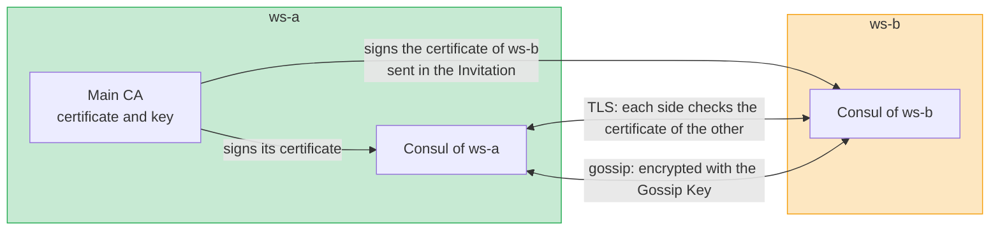

# The Yard

A Yard is the set of Workstations on one LAN that see each other's Services. No Workstation is the boss. Each one runs its own Consul, and the Consuls of the Yard federate. So a Workstation that is off does not stop the others.



## The parts of a join

- **Peer.** The LAN address of a Workstation that a joining Workstation uses to find the Yard. One is enough. The first Workstation of a Yard has none. After a join, the Workstation that shared saves its Peers with `ws yard peers --sync`.
- **Gossip Key.** The secret of the Yard. Every Workstation needs the same key.
- **Invitation.** An encrypted zip file that `ws yard share` makes for one joining Workstation. It holds the Gossip Key, the certificate of the Main CA, the Consul certificate and key of the joining Workstation, and the address of the Workstation that shares. Its password travels by another way.
- **Main CA.** The Workstation CA of the Workstation that shares the Yard. It signs the Consul certificate of every Workstation, and every Workstation trusts it for Consul. Any Workstation CA can be the Main CA.

Only the Workstation that holds the key of the Main CA can share. A Workstation that joined has only the certificate, so it cannot invite a third one.

!!! warning "The Gossip Key opens the Yard"

    Anyone who has the Gossip Key and can reach a Workstation on the LAN can join the Yard. Send the Invitation and its password by two different ways. See [SECURITY.md](https://github.com/ppalazon/lvh-yard/blob/main/SECURITY.md).

To make a Yard, see [Create a Yard and join it](../recipes/reach/create-a-yard.md).

## When a Workstation is off

Its Consul does not answer, so the others call it an Unreachable Workstation. They do not show its Services until it answers again. Their own Services and Routes keep working. The catalog and the status say which Workstation does not answer:

```text
ws-b: Workstation unreachable
To see why, run:
  lvh-yard ws compose logs consul
```

```text
LVH Yard on this Workstation: warning
  WARN  Consul: Consul cannot read from ws-b, though its WAN pool lists it as alive.
```

An [Alias](../recipes/choose/swap-with-an-alias.md) to a Service of that Workstation is `unreachable`, and the Route uses the next source. When the Workstation answers again, its Services come back in the catalog.

## Leave a Yard

On the Workstation that leaves, run:

```sh
lvh-yard ws yard standalone
```

```text
This Workstation is standalone.
  Gossip Key: new
  Peers: none
  Consul TLS: off
Saved .env.
Next:
  lvh-yard ws --dir '...' compose recreate
```

The command makes a new Gossip Key, clears the Peers, turns Consul TLS off and removes the Consul certificate. The CA and the certificates that it signed stay. The old members of the Yard keep the old Gossip Key, and nothing revokes the Consul certificate that they hold.
