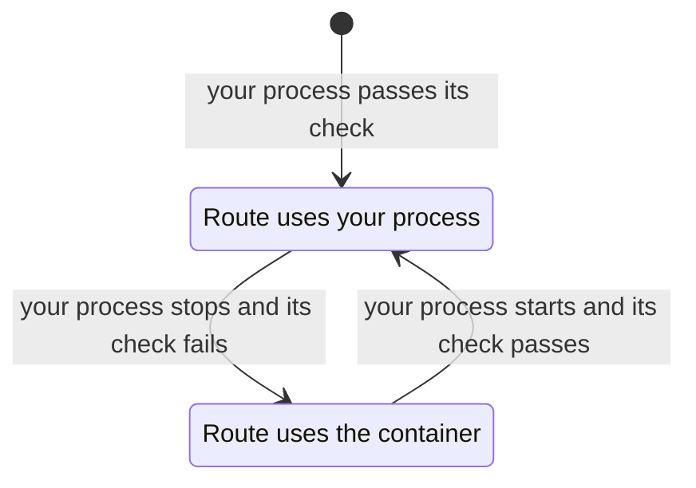

# Put your process before the container

"I develop an application that I usually run as a Docker container. I changed its code, and I want to see the change under the same name."

You run your modified copy as a process, and you put it first in the order of the Instance Sources. The Route uses the first source that has a passing Instance. So the hostname shows your copy while it runs, and the container when it does not.

The examples use Mailpit. You develop Mailpit, and you usually run it as a Docker container. [Your first Service](../../start/first-service.md) follows that container with the Service `mailpit`. After a change, you build your copy and run it on your computer.

This recipe adds your copy as a second source and puts it first. While your copy runs, `http://mailpit.lvh.me` shows it. When you stop it, the container answers again. When you start it again, the hostname returns to your copy.



## Before you start

You need:

- A running Workstation. `lvh-yard status` starts with `LVH Yard on this Workstation: ok`.
- A Base Domain. See [Pick your Base Domain](../../start/pick-your-base-domain.md). The examples use `lvh.me`.
- A published Service that follows a container. [Your first Service](../../start/first-service.md) creates `mailpit` with the container `mailpit-1`. The examples use them.
- Your modified copy of Mailpit, built from its source and running as a process that listens on `127.0.0.1:8025`. Docker gives the container another Host Port, so the two never share a port.

## CLI Steps

1. Register your process as a Static Instance. Give `--host 127.0.0.1` for an app that listens on localhost only.

    ```sh
    lvh-yard register static mailpit --host 127.0.0.1 --port 8025
    ```

    ```text
    Registered mailpit at 127.0.0.1:8025, Instance 32621298-cd67-4cb4-ae17-f55e3b56d40d.
    ```

    A new source goes to the end of the order, so the container still answers.

2. Read the order. `(in use)` marks the source that the Route uses.

    ```sh
    lvh-yard priority mailpit
    ```

    ```text
    Instance Priority of mailpit: on. The Route uses the first Instance Source with a passing Instance.
      1. mailpit-1:8025  Container Binding to container mailpit-1, port 8025  (in use)
      2. 32621298-cd67-4cb4-ae17-f55e3b56d40d  Static Instance 127.0.0.1:8025
    ```

3. Put your process first. Give its ID. The other sources follow in their order.

    ```sh
    lvh-yard priority mailpit 32621298-cd67-4cb4-ae17-f55e3b56d40d
    ```

    ```text
    Instance Priority of mailpit: on. The Route uses the first Instance Source with a passing Instance.
      1. 32621298-cd67-4cb4-ae17-f55e3b56d40d  Static Instance 127.0.0.1:8025  (in use)
      2. mailpit-1:8025  Container Binding to container mailpit-1, port 8025
    ```

    Open `http://mailpit.lvh.me` in your browser. Traefik needs a few seconds to pick up the new order. Then your process answers.

## Dashboard Steps

- Open `http://yard.<Base Domain>` or [`http://127.0.0.1:7780`](http://127.0.0.1:7780).
- Click `mailpit` on the `Catalog` page.
- In the `Instance Sources` card, click `Add Static Instance`. Fill `Host` and `Port`, and click `Add`.
- Click the up arrow at the right of the new source.
- The `Instance Priority` switch enables and disables the order.
- Follow the forms.

## Check

`lvh-yard catalog` names the kind of source that the Route uses, in brackets:

```sh
lvh-yard catalog
```

```text
  mailpit        healthy  local  mailpit.lvh.me        1/1  [static]
```

Stop your process. For about 15 seconds, the hostname answers `502 Bad Gateway`. The health check of your process must fail first. Then the container answers. The Service is `degraded`, and the kind is `[docker]`:

```text
  mailpit        degraded  local  mailpit.lvh.me        1/1  [docker]
```

`lvh-yard catalog --details` shows the Instance that fails, and the Instance that the Route uses:

```sh
lvh-yard catalog --details
```

```text
  mailpit: degraded at mailpit.lvh.me
    Instance Priority: on
      1. 32621298-cd67-4cb4-ae17-f55e3b56d40d  Static Instance 127.0.0.1:8025
      2. mailpit-1:8025  Container Binding to container mailpit-1, port 8025  (in use)
    127.0.0.1:8025  critical  32621298-cd67-4cb4-ae17-f55e3b56d40d
    127.0.0.1:33694  passing   mailpit:mailpit-1:8025  routed
```

Start your process again. After about 15 seconds, the hostname returns to your process.

## Undo

Remove your process. The container keeps answering.

```sh
lvh-yard remove mailpit --host 127.0.0.1 --port 8025
```

To keep both sources, disable the order. Then every passing Instance shares the requests, and the hostname alternates between your process and the container. The order stays, and `--on` enables it again.

```sh
lvh-yard priority mailpit --off
lvh-yard priority mailpit --on
```

## Troubleshooting

### The container answers, and my process runs

Two causes are possible. Read the order first:

```sh
lvh-yard priority mailpit
```

If your process is second, repeat step 3 with its ID.

If your process is first, its check fails. `lvh-yard catalog --details` shows `critical` for it. `lvh-yard test mailpit` names the cause:

```text
Reachability of mailpit on ws-a, from this Workstation:
  FAIL  Instance 127.0.0.1:8025 (not in the Route now): Connection refused (connect failed)
  ok    Instance 127.0.0.1:33694 (in the Route)
  ok    Route http://mailpit.lvh.me: answered 200
  ok    Route https://mailpit.lvh.me: answered 200
The Route uses the bound Instance Source mailpit-1:8025 now.
1 of 4 checks failed.
```

Nothing listens on that host and port. Start your process there, or remove the Static Instance and register the right host and port. See [Connection refused](../../start/first-service.md#connection-refused).

### `502 Bad Gateway` after I stop my process

The Route keeps the Instance until its health check fails. The default check runs every 10 seconds, so the answer lasts up to about 15 seconds. Then the container answers.

### The hostname alternates between my process and the container

The Instance Priority is off. `lvh-yard priority mailpit` prints `Instance Priority of mailpit: off.` Enable it:

```sh
lvh-yard priority mailpit --on
```
