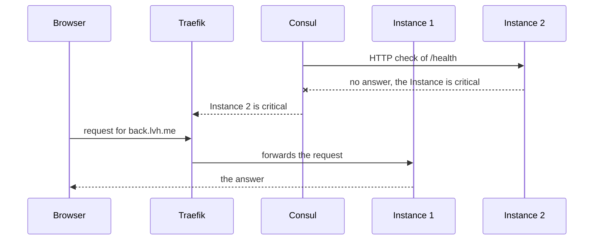

# Test replicas and failover

"I want to see what my frontend does when one of two backends dies."

A Service can have two Instances. A health check on each one tells Traefik which Instances to use. While one Instance fails its check, the Service is `degraded`, and the Route uses the Instance that passes.



## Before you start

You need:

- A running Workstation. `lvh-yard status` starts with `LVH Yard on this Workstation: ok`.
- A Base Domain. See [Pick your Base Domain](../../start/pick-your-base-domain.md). The examples use `lvh.me`.
- Your backend, started twice, on ports 4001 and 4002. Each copy answers `GET /health` with a 2xx status. The examples use two copies that print `replica 1` and `replica 2`.

## CLI Steps

1. Create the Service.

    ```sh
    lvh-yard service create back
    ```

2. Register both copies as Static Instances. `--path` makes an HTTP check: the Instance passes while `/health` answers 2xx. Without `--path`, the check only connects to the port. The check runs every 10 seconds, and it times out after 2 seconds. `--interval` and `--timeout` change both, and the examples use short times so that the test is quick.

    ```sh
    lvh-yard register static back --host 127.0.0.1 --port 4001 --path /health --interval 5s --timeout 1s
    lvh-yard register static back --host 127.0.0.1 --port 4002 --path /health --interval 5s --timeout 1s
    ```

    ```text
    Registered back at 127.0.0.1:4001, Instance 7d56593e-3096-45c4-bb9f-6bcb05a3c305.
    Registered back at 127.0.0.1:4002, Instance 0a9ce0e9-88fe-4abd-bef4-cb1afa15314d.
    ```

3. Publish the Service.

    ```sh
    lvh-yard publish back
    ```

4. Make the copies share the requests. Two Static Instances are two Instance Sources, and Instance Priority uses only the first one that passes. Turn the Instance Priority off. Then every passing Instance shares the Route.

    ```sh
    lvh-yard priority back --off
    ```

    ```text
    Instance Priority of back: off. Every passing Instance of every Instance Source shares the Route.
    ```

    Open `http://back.lvh.me` in your browser. Traefik needs a few seconds to pick up the order.

## Dashboard Steps

- Open `http://yard.<Base Domain>` or [`http://127.0.0.1:7780`](http://127.0.0.1:7780).
- Click `New Service` on the `Catalog` page and create `back`. On its page, click `Add Static Instance`. Fill `Host` and `Port`, choose `HTTP` in `Health check`, and fill `HTTP path`, `Interval` and `Timeout`. Click `Add`. Repeat for the second copy.
- Switch `Published` on.
- Switch `Instance Priority` off.
- On the page of the Service, open an Instance to read the output of its checks.
- Follow the forms.

## Check

`lvh-yard catalog` counts the passing Instances. `2/2` means that both copies pass:

```sh
lvh-yard catalog
```

```text
  back           healthy  local  back.lvh.me           2/2  [static]
```

Ask the hostname six times. The answers alternate between the copies:

```sh
for i in 1 2 3 4 5 6; do curl -s http://back.lvh.me; done
```

```text
replica 2 replica 1 replica 2 replica 1 replica 2 replica 1
```

Stop the first copy. Then watch the hostname each second. The answers are the status codes of four requests. For about six seconds, half of the requests fail, because the Route still uses the stopped Instance. Then the check turns it `critical`, and Traefik stops using it:

```text
 0s: 200 502 200 502
 5s: 200 502 200 502
 6s: 200 200 200 200
13s: 200 200 200 200
```

The Service is `degraded`, and the counter is `1/2`:

```sh
lvh-yard catalog
```

```text
  back           degraded  local  back.lvh.me           1/2  [static]
```

`lvh-yard catalog --details` shows which Instance fails, and which one the Route uses:

```sh
lvh-yard catalog --details
```

```text
  back: degraded at back.lvh.me
    Instance Priority: off
      1. 7d56593e-3096-45c4-bb9f-6bcb05a3c305  Static Instance 127.0.0.1:4001
      2. 0a9ce0e9-88fe-4abd-bef4-cb1afa15314d  Static Instance 127.0.0.1:4002
    127.0.0.1:4001  critical  7d56593e-3096-45c4-bb9f-6bcb05a3c305
    127.0.0.1:4002  passing   0a9ce0e9-88fe-4abd-bef4-cb1afa15314d  routed
```

`lvh-yard test` names the stopped copy:

```sh
lvh-yard test back
```

```text
Reachability of back on ws-a, from this Workstation:
  FAIL  Instance 127.0.0.1:4001 (not in the Route now): Connection refused (connect failed)
  ok    Instance 127.0.0.1:4002 (in the Route)
  ok    Route http://back.lvh.me: answered 200
  ok    Route https://back.lvh.me: answered 200
The Instance Priority is off. The Route uses every passing Instance, or every Instance in range if none passes.
1 of 4 checks failed.
```

Start the first copy again. After about six seconds, the answers alternate again, and the counter is `2/2`.

The times depend on `--interval`. With the default of 10 seconds, the failing requests last up to about 15 seconds. To use the second copy only when the first one fails, turn the Instance Priority on again.

## Undo

Delete the Service. It leaves your copies running.

```sh
lvh-yard service delete back
```

## Troubleshooting

### Every answer comes from the first copy

The Instance Priority is on. The Route uses only the first Instance Source that passes, so the second copy waits. Six requests answer:

```text
replica 1 replica 1 replica 1 replica 1 replica 1 replica 1
```

Turn it off with `lvh-yard priority back --off`.

### `502 Bad Gateway` for a few seconds after a copy stops

The Route keeps the Instance until its check fails. With `--interval 5s` the failing requests lasted six seconds. Use a shorter `--interval` and `--timeout` for a quicker switch.

### `degraded`, and `lvh-yard test` says `Every check passed`

The port answers, but `/health` does not answer 2xx. The HTTP check turns the Instance `critical`, and the Route does not use it. `lvh-yard test` tests an Instance with a plain connection, so it says `ok` and marks the Instance `not in the Route now`:

```text
    127.0.0.1:4001  critical  7d56593e-3096-45c4-bb9f-6bcb05a3c305
    127.0.0.1:4002  passing   0a9ce0e9-88fe-4abd-bef4-cb1afa15314d  routed
```

```text
Reachability of back on ws-a, from this Workstation:
  ok    Instance 127.0.0.1:4001 (not in the Route now)
  ok    Instance 127.0.0.1:4002 (in the Route)
  ok    Route http://back.lvh.me: answered 200
  ok    Route https://back.lvh.me: answered 200
The Instance Priority is off. The Route uses every passing Instance, or every Instance in range if none passes.
Every check passed.
```

The page of the Service in the dashboard shows the output of the check, for example `HTTP GET http://127.0.0.1:4001/health: 404`. Make `/health` answer 2xx, or register the Instance without `--path`.

### `unhealthy` with `0/2`

Both copies fail. The hostname answers `502`:

```text
  back           unhealthy  local  back.lvh.me           0/2  [static]
```

`lvh-yard test back` lists both Instances as `FAIL`. Start the copies.
