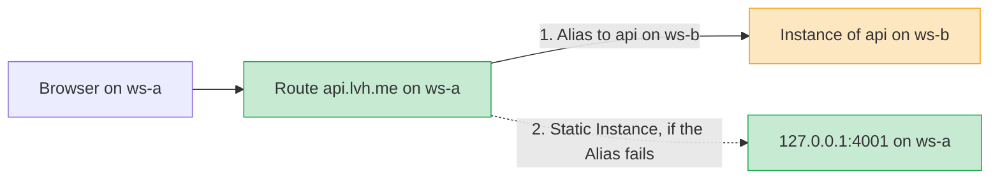

# Swap a backend with an Alias

"I want my local `api` to use the `api` that runs on a coworker's Workstation, and go back later."

An Alias adds the Instances of a Remote Service to your Service. The Route of `api` on your Workstation then reaches the Workstation of your coworker. You remove the Alias to go back.



## Before you start

You need:

- **ws-a**{.ws-a} Your Workstation, with the Service `api` published. Its Static Instance is your own copy, at `127.0.0.1:4001`.
- **ws-b**{.ws-b} The Workstation of your coworker, in the same Yard. See [Create a Yard and join it](../reach/create-a-yard.md).
- **ws-b**{.ws-b} A Service `api` with Yard Scope and an Instance at the LAN address of `ws-b`. An Instance on loopback gives your Workstation nothing to reach. See [Show your work to a teammate](../reach/show-your-work.md).

```sh
lvh-yard register static api --host 192.168.1.67 --port 4002
lvh-yard publish api --scope yard
```

## CLI Steps

1. **ws-a**{.ws-a} Find the Remote Service. The catalog lists the Services of `ws-b` with Yard Scope.

    ```sh
    lvh-yard catalog
    ```

    ```text
    ws-b
      api            healthy  yard   api.ws-b.lvh.me       1/1  [static]
    ```

2. **ws-a**{.ws-a} Add the Alias to your Service `api`.

    ```sh
    lvh-yard alias add api --workstation ws-b --service api
    ```

    ```text
    Added the Alias to api on ws-b to the Service api.
    ```

3. **ws-a**{.ws-a} List the Aliases of `api`. `active` means that the Alias gives the Instances of the Remote Service.

    ```sh
    lvh-yard alias list api
    ```

    ```text
    api on ws-b: active
    ```

4. **ws-a**{.ws-a} Read the order of the Instance Sources. A new Alias goes to the end, so your own Instance still answers.

    ```sh
    lvh-yard priority api
    ```

    ```text
    Instance Priority of api: on. The Route uses the first Instance Source with a passing Instance.
      1. d099aecf-d74c-4b17-abc5-bb2bd56ee5ff  Static Instance 127.0.0.1:4001  (in use)
      2. ws-b/api  Alias to api on ws-b
    ```

5. **ws-a**{.ws-a} Put the Alias first. The ID of an Alias is `<workstation>/<service>`.

    !!! warning "A Service with Yard Scope and an Alias first gives different answers"

        Other Workstations skip your Aliases. If `api` has Yard Scope, the Route of a teammate uses your own Instance, and your Route uses the Instance of `ws-b`. `lvh-yard publish` prints the risk `Alias order`. Keep the Scope of `api` on Local while the Alias is first.

    ```sh
    lvh-yard priority api ws-b/api
    ```

    ```text
    Instance Priority of api: on. The Route uses the first Instance Source with a passing Instance.
      1. ws-b/api  Alias to api on ws-b  (in use)
      2. d099aecf-d74c-4b17-abc5-bb2bd56ee5ff  Static Instance 127.0.0.1:4001
    ```

    Open `http://api.lvh.me` in your browser. Traefik needs a few seconds to pick up the new order. The answer comes from `ws-b`.

## Dashboard Steps

- **ws-a**{.ws-a} Open `http://yard.<Base Domain>` or [`http://127.0.0.1:7780`](http://127.0.0.1:7780).
- **ws-a**{.ws-a} Click `api` of `ws-b` on the `Catalog` page. Click `Alias`, choose one of your Services or type a new name, and click `Add`. A new name creates the Service and publishes it with Local Scope.
    - **ws-a**{.ws-a} Alternatively, on the page of your own `api`, `Add Alias` in the `Instance Sources` card. Choose the Remote Service in `Remote Service` and click `Add`.
- **ws-a**{.ws-a} Click the up arrow at the right of the Alias to put it first.
- Follow the forms.

## Check

**ws-a**{.ws-a} The catalog names the kind of source that the Route uses. For `api` it is `[alias]`:

```sh
lvh-yard catalog
```

```text
  api            healthy  local  api.lvh.me            1/1  [alias]
```

`lvh-yard test` tells which Instance the Route uses:

```sh
lvh-yard test api
```

```text
Reachability of api on ws-a, from this Workstation:
  ok    Instance 127.0.0.1:4001 (not in the Route now)
  ok    Instance 192.168.1.67:4002 (in the Route)
  ok    Route http://api.lvh.me: answered 200
  ok    Route https://api.lvh.me: answered 200
The Route sends requests to the Alias's Remote Service: api on ws-b.
Every check passed.
```

## Undo

**ws-a**{.ws-a} Remove the Alias. The Route uses your own Instance again:

```sh
lvh-yard alias remove api --workstation ws-b --service api
```

```text
Removed the Alias to api on ws-b from api.
```

## Troubleshooting

### `Only a Remote Service with Yard Scope can be the target of an Alias.`

`alias add` refuses a Remote Service that has Local Scope:

```text
ws-b publishes notes with Local Scope only. Only a Remote Service with Yard Scope can be the target of an Alias.
```

**ws-b**{.ws-b} Share the Service:

```sh
lvh-yard publish notes --scope yard
```

### `An Alias is only for a Remote Service`

The Service that you named is on your own Workstation:

```text
An Alias is only for a Remote Service, and ws-a is this Workstation.
```

Give the Workstation of your coworker in `--workstation`.

### `not-shared`

The Alias stays, but it gives no Instances. `ws-b` unpublished `api`, or it set the Scope to Local. The Route uses the next source:

```text
api on ws-b: not-shared
  ws-b publishes api with Local Scope only.
```

**ws-b**{.ws-b} Share the Service again with `lvh-yard publish api --scope yard`. The Alias gives its Instances again.

### `unavailable`

`alias add` prints a warning, and the state is `unavailable`:

```text
Warning: api2 has no Instance this Workstation can reach.
```

```text
api2 on ws-b: unavailable
  api2 has no Instance this Workstation can reach.
```

The Instance of the Remote Service is on loopback, so only `ws-b` reaches it. **ws-b**{.ws-b} Register the Instance at the LAN address. See [Show your work to a teammate](../reach/show-your-work.md).

### `unreachable`

`ws-b` does not answer, for example because its containers stopped. The Route uses the next source, so your own Instance answers:

```text
api on ws-b: unreachable
  Workstation ws-b is unreachable: its Consul does not answer.
```

**ws-b**{.ws-b} Start its containers with `lvh-yard ws compose start`. The Alias gives the Instances again when `ws-b` answers.
