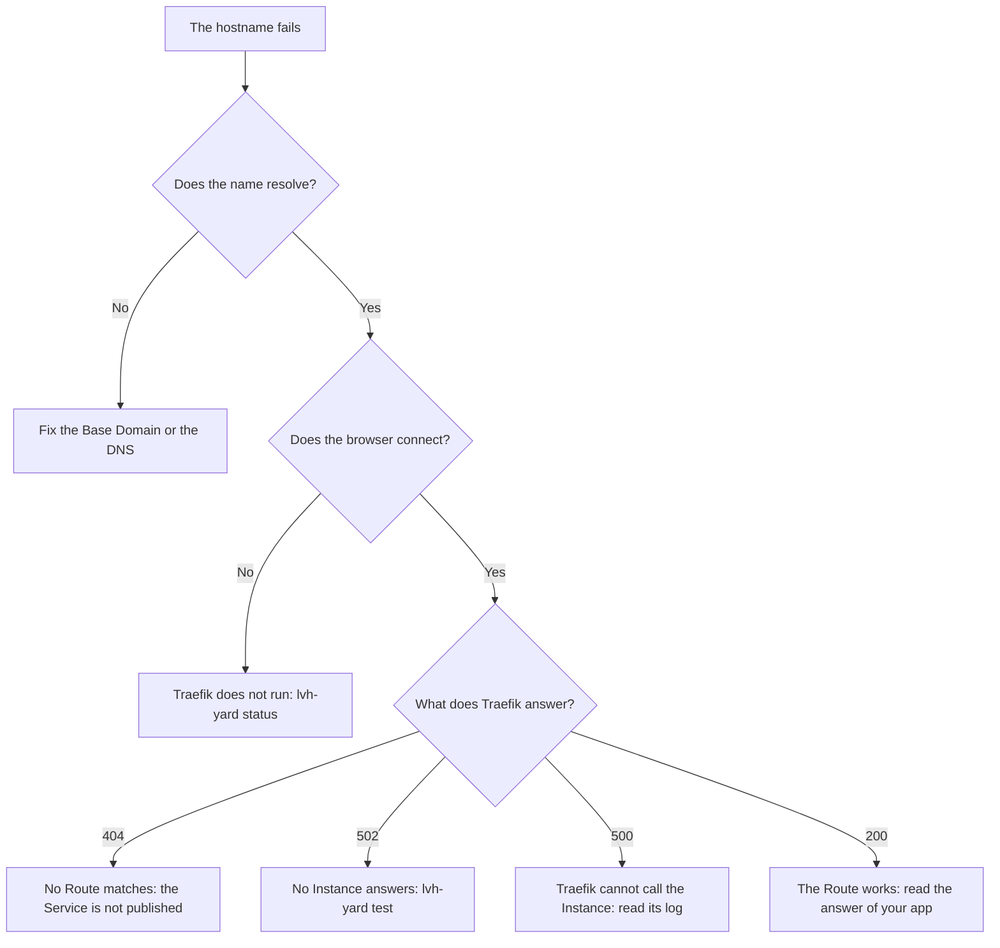

# Find and fix a bad Route

"My service doesn't receive anything by Traefik, and I do not know why."

You name the cause in a few minutes. The answer of the hostname says where to look. Then `lvh-yard catalog`, `lvh-yard test`, `lvh-yard status` or the access log of Traefik names the cause.



## Before you start

You need:

- A running Workstation.
- A Service whose hostname fails. The examples use `web`, a Static Instance at `127.0.0.1:4000`, and the Base Domain `lvh.me`.

## CLI Steps

1. Ask the hostname and read the answer. `curl` prints the status line with `-i`.

    ```sh
    curl -i http://web.lvh.me
    ```

    | Answer                                 | Cause                            | Go to                                                   |
    | -------------------------------------- | -------------------------------- | ------------------------------------------------------- |
    | `Could not resolve host`               | DNS does not answer              | [Could not resolve host](#could-not-resolve-host)       |
    | `Failed to connect` and no status line | Traefik does not run             | [Failed to connect](#failed-to-connect)                 |
    | `404 page not found`                   | No Route matches                 | [404 page not found](#404-page-not-found)               |
    | `502 Bad Gateway`                      | No Instance answers              | [502 Bad Gateway](#502-bad-gateway)                     |
    | `500 Internal Server Error`            | Traefik cannot call the Instance | [500 Internal Server Error](#500-internal-server-error) |

2. Read the state of the Service. The states are `unpublished`, `unavailable`, `unhealthy`, `degraded` and `healthy`.

    ```sh
    lvh-yard catalog
    ```

3. Read the Instances and the Service Warnings. An `error` warning says what stops the hostname. A `risk` warning says that the hostname works, but another Workstation or user can meet a problem.

    ```sh
    lvh-yard catalog --details
    ```

4. Test what this Workstation reaches. The test names each Instance and each Route that fails.

    ```sh
    lvh-yard test web
    ```

5. Check Consul, Traefik and Docker.

    ```sh
    lvh-yard status
    ```

6. Log each request that reaches the Route. Then ask the hostname again and read the log. A new Route needs a few seconds before Traefik uses it.

    ```sh
    lvh-yard publish web --access-log on
    lvh-yard ws compose logs traefik
    ```

    The log of Traefik is long. The newest lines are at the end.

## Dashboard Steps

- Open `http://yard.<Base Domain>` or [`http://127.0.0.1:7780`](http://127.0.0.1:7780).
- Click the Service on the `Catalog` page. The alert at the right of the hostname names the problem. Click its title to open or close its text.
- `Test Reachability` runs the same checks as `lvh-yard test`.
- `Route Diagram` shows the listeners of Traefik, the Route Profiles and each Instance with its state. It sends no request.
- In the `Instance Sources` card, open an Instance to read the output of its checks.
- The switch `Show in the access log` in the `Publication` card enables the access log.
- Follow the forms.

## Check

After the fix, the test passes and the hostname answers `200`:

```sh
lvh-yard test web
```

```text
Reachability of web on ws-a, from this Workstation:
  ok    Instance 127.0.0.1:4000 (in the Route)
  ok    Route http://web.lvh.me: answered 200
  ok    Route https://web.lvh.me: answered 200
The Route uses the static Instance Source 1d61f97d-cfa8-48a2-b64a-13e7fc370b20 now.
Every check passed.
```

## Undo

The access log adds a line for every request. Disable it when you finish:

```sh
lvh-yard publish web --access-log off
```

## Troubleshooting

### `Could not resolve host`

`curl` prints `curl: (6) Could not resolve host: web.lvh.me`. DNS does not answer for the Base Domain. See [Could not resolve host](../../start/pick-your-base-domain.md#could-not-resolve-host).

### `Failed to connect`

`curl` prints `curl: (7) Failed to connect` and the browser cannot connect. Nothing listens at the address of the hostname, so Traefik does not run. The catalog can still say `healthy`, because it does not ask Traefik. `lvh-yard status` says `failing`, and `lvh-yard test` names the address:

```text
LVH Yard on this Workstation: failing
  ok    Consul: Consul has a leader, and 1 Workstation is in its WAN pool.
  FAIL  Traefik: Traefik does not answer its ping at http://127.0.0.1:80/ping. Make sure that it runs.
  ok    Docker: Docker answers.
```

```text
Reachability of web on ws-a, from this Workstation:
  ok    Instance 127.0.0.1:4000 (in the Route)
  FAIL  Route http://web.lvh.me: Traefik does not answer at http://127.0.0.1:80: Connection refused (connect failed). Make sure that Traefik runs on this Workstation and listens at that address.
```

Start the containers of the Workstation:

```sh
lvh-yard ws compose start
```

### `404 page not found`

Traefik has no Route for this hostname. The usual cause is a Service that is not published. The catalog shows `unpublished`, with no hostname:

```text
  web            unpublished                               1/1
```

`lvh-yard test` tests only its Instances and says `Not published, so only its Instances are tested.` Publish it:

```sh
lvh-yard publish web
```

If the catalog shows a hostname for the Service, compare it with the hostname that you typed. A different Base Domain, or a typo, also gives a `404`.

Your own app can answer `404` too. The access log tells the two apart. Traefik names the Route and the Instance that it used. A `404` with `"-" "-"` matched no Route. A `404` with a Route and an Instance came from your app:

```text
traefik-1  | 127.0.0.1 - - [23/Nov/2026:15:35:10 +0000] "GET / HTTP/1.1" 404 19 "-" "-" 3 "-" "-" 0ms
traefik-1  | 127.0.0.1 - - [23/Nov/2026:15:35:10 +0000] "GET /missing HTTP/1.1" 404 460 "-" "-" 4 "web@http" "http://127.0.0.1:4000" 0ms
```

A Service with mutual TLS also gives `404` when the Workstation has no mutual TLS. The catalog says `healthy`, and `lvh-yard test` says that Traefik has no Route for the hostname. `lvh-yard catalog --details` shows the cause as a Service Warning:

```text
    error: [Mutual TLS] No mutual TLS on this Workstation. Turn it on, or turn it off for this Service.
```

Turn it on, and apply the change. If you never ran `lvh-yard ws tls mtls create`, run it first. See [HTTPS to a Service](../https/workstation-ca.md#https-to-a-service).

```sh
lvh-yard ws tls mtls enable
lvh-yard ws compose recreate
```

### `502 Bad Gateway`

Traefik matched the Route, but no Instance answered. The catalog shows `unhealthy` with `0/1` Instances. `lvh-yard test` names the cause:

```text
  web            unhealthy  local  web.lvh.me            0/1  [static]
```

```text
Reachability of web on ws-a, from this Workstation:
  FAIL  Instance 127.0.0.1:4000 (in the Route): Connection refused (connect failed)
  FAIL  Route http://web.lvh.me: Traefik answered 502: no Instance answered.
  FAIL  Route https://web.lvh.me: Traefik answered 502: no Instance answered.
No Instance passes. The Route uses every Instance in range.
3 of 3 checks failed.
```

Nothing listens at the address of the Instance. Start your process there. If the port is wrong, remove the Instance and register the right one. See [Your first Service](../../start/first-service.md#connection-refused) for a process and [Stop chasing Compose ports](../name/compose-ports.md#connection-refused) for a container.

### `500 Internal Server Error`

Traefik matched the Route, but it could not open a connection to an Instance. The catalog says `healthy`, because the Instance passes its own check. A Service with mutual TLS gives this error when Traefik refuses the certificate of the Service. The example is the Service `echo`, a Container Binding to the `mendhak/http-https-echo` container on port 8443. `lvh-yard test` fails, and its text asks you to read the log of Traefik:

```text
Reachability of echo on ws-a, from this Workstation:
  ok    Instance 127.0.0.1:33702 (in the Route)
  FAIL  Route http://echo.lvh.me: Traefik answered 500: it could not set up a connection to an Instance. ...
```

The log of Traefik names the certificate that it refused:

```sh
lvh-yard ws compose logs traefik
```

```text
traefik-1  | 2026-11-23T15:56:53Z ERR 500 Internal Server Error error="tls: failed to verify certificate: x509: certificate is valid for my.example.com, my.example.net, not echo"
```

Traefik checks that the certificate of each Instance names the Service, here `echo`. This container serves its own certificate for other names. A certificate that you signed for another Service gives the same error, with the names of that certificate:

```text
traefik-1  | 2026-11-23T15:57:41Z ERR 500 Internal Server Error error="tls: failed to verify certificate: x509: certificate is valid for other, localhost, not echo"
```

Sign a certificate for the Service. The command asks for a password for the zip file. Then run the container with `service-fullchain.crt` and `service.key`. This image reads them at `/app/fullchain.pem` and `/app/testpk.pem`, and `MTLS_ENABLE=1` makes it ask Traefik for its certificate. The new container has a new Host Port, and the Container Binding follows it:

```sh
lvh-yard ws tls ca issue service echo
docker rm -f echo
docker run -d --name echo -p 8443 -e MTLS_ENABLE=1 \
  -v ~/.config/lvh-yard/ca/service/echo/service-fullchain.crt:/app/fullchain.pem:ro \
  -v ~/.config/lvh-yard/ca/service/echo/service.key:/app/testpk.pem:ro \
  mendhak/http-https-echo
```

After a few seconds, `lvh-yard test echo` passes. The container echoes the certificate that Traefik showed, so the answer proves the mutual TLS:

```sh
curl -s http://echo.lvh.me | grep -A3 clientCertificate
```

```text
  "clientCertificate": {
    "subject": {
      "CN": "traefik-ws-a"
    },
```
