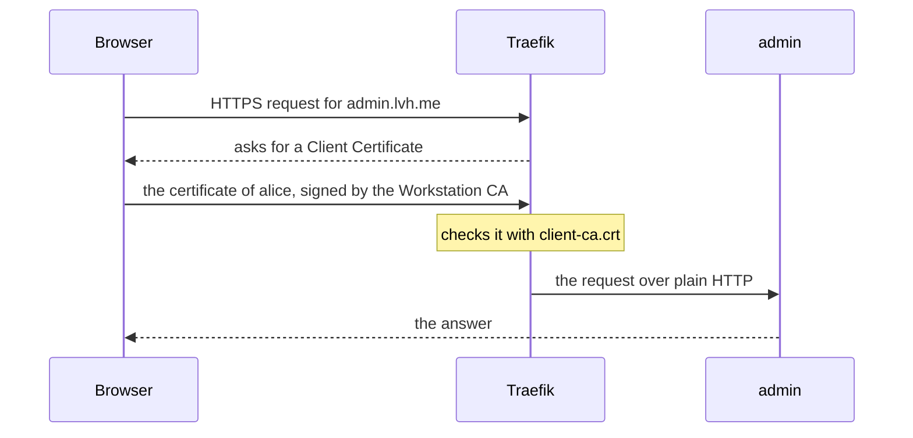

# Require a Client Certificate

"Only people with my certificate should open this internal tool."

A Route Profile with `clientCertificate: {}` makes the Route answer only on HTTPS, and only to a browser that shows a Client Certificate from your Workstation CA.



## Before you start

You need:

- A running Workstation with HTTPS, and a browser that trusts the Workstation CA. See [Test HTTPS with your Workstation CA](workstation-ca.md), steps 1 to 4.
- A Base Domain. See [Pick your Base Domain](../../start/pick-your-base-domain.md). The examples use `lvh.me`.
- A published Service. The examples use `admin`, the container `mendhak/http-https-echo` on port 8080. It echoes the headers of each request.

```sh
docker run -d --name echo -p 8080 mendhak/http-https-echo
lvh-yard service create admin
lvh-yard register container echo --port 8080 --service admin
lvh-yard publish admin
```

## CLI Steps

1. Make Traefik trust the Workstation CA for Client Certificates. This signs nothing. It names the CA that checks the certificates of people.

    ```sh
    lvh-yard ws tls client create
    ```

    ```text
    Traefik asks for a Client Certificate on Routes whose Route Profile has clientCertificate: {}.
    ```

2. Apply the change.

    ```sh
    lvh-yard ws compose recreate
    ```

3. Save a Route Profile with the reserved option `clientCertificate: {}`. Write this in `profiles.yaml`:

    ```yaml
    http:
      middlewares:
        certificate:
          clientCertificate: {}
    ```

    ```sh
    lvh-yard profiles set profiles.yaml
    ```

    ```text
    Saved the Route Profile certificate.
    ```

4. Publish the Service with the profile. The hostname answers only on HTTPS from now on.

    !!! warning "A Client Certificate protects the hostname, not the port"

        A connection straight to the port of the Instance does not go through Traefik. Anyone who reaches that port needs no certificate. See [Protect a dev service with Route Profiles](route-profiles.md).

    ```sh
    lvh-yard publish admin --profile certificate
    ```

    ```text
    Published admin at admin.lvh.me.
      Scope: Local
      State: unhealthy
      Route Profiles: certificate
    risk: [Authenticated Route] The Route Profile certificate asks who the user is only on the hostname. A direct connection to 127.0.0.1:33708 skips it. Make the Service check its users.
    ```

5. Sign a Client Certificate for a person. The command asks for a password for the `.p12` file. Give `--password <password>` to skip the question. Without a password, it makes a random one and prints it once.

    ```sh
    lvh-yard ws tls ca issue user alice
    ```

    ```text
    Client Certificate saved in .../ca/client/alice.p12.
    ```

    !!! warning "The file and its password open the tool"

        Send `alice.p12` to Alice, and send its password by another way than the file. Send `ca/ca.crt` too, so her browser trusts the HTTPS certificate. Never send `ca/ca.key`.

6. Alice imports `alice.p12` into the personal certificates of her browser.

    === "Linux and macOS"

        In Firefox, open Settings, Privacy & Security, Certificates, View Certificates, then Your Certificates, and choose Import. In a Chromium browser, open the certificate manager from Settings and import the file into personal certificates. The operating system may manage this store. Follow its instructions then.

    === "Windows (not tested)"

        ```powershell
        $password = Read-Host -AsSecureString 'Password of alice.p12'
        Import-PfxCertificate -FilePath "$ws\ca\client\alice.p12" -CertStoreLocation Cert:\CurrentUser\My -Password $password
        ```

        Firefox has its own store. Use the import of its certificate manager. A copy of the file in another folder gets the access rights of that folder, so import the file and delete the copy.

    Open `https://admin.lvh.me` in the browser. It asks which certificate to show. Choose the one of Alice.

7. Optional: tell the Service who the person is. Chain `certificate` with the Traefik middleware `passTLSClientCert`. Traefik then adds the name of the certificate to each request. Write this in `profiles.yaml`, and save it:

    ```yaml
    http:
      middlewares:
        certificate:
          clientCertificate: {}
        cert-info:
          passTLSClientCert:
            info:
              subject:
                commonName: true
        secure-with-user:
          chain:
            middlewares:
              - certificate
              - cert-info
    ```

    ```sh
    lvh-yard profiles set profiles.yaml
    lvh-yard publish admin --profile secure-with-user
    ```

    The Service reads the header `X-Forwarded-Tls-Client-Cert-Info`. The Service must trust it only on connections from Traefik.

## Dashboard Steps

- The dashboard has no form to make a certificate. Use the CLI Steps.
- Open `http://yard.<Base Domain>` or [`http://127.0.0.1:7780`](http://127.0.0.1:7780).
- Open `Route Profiles` and click `New Route Profile`. The `Examples` sidebar has `Client Certificate` and `Client Certificate user`. Copy one into `Route options` and save it.
- Click `admin` on the `Catalog` page. In the `Route Profiles` card, choose the profile in `Route Profile to add` and click `Add`.
- In the `Catalog`, a lock next to a hostname opens its `https` address.
- Follow the forms.

## Check

`lvh-yard test` needs no certificate. It checks that Traefik asks for one:

```sh
lvh-yard test admin
```

```text
Reachability of admin on ws-a, from this Workstation:
  ok    Instance 127.0.0.1:33708 (in the Route)
  ok    Route https://admin.lvh.me: Traefik asks for a Client Certificate, as the Route requires. This test has none.
The Route uses the bound Instance Source echo:8080 now.
Every check passed.
```

A request with no certificate fails during the handshake. `--cacert` names the Workstation CA for the HTTPS certificate:

```sh
curl --cacert ~/.config/lvh-yard/ca/ca.crt https://admin.lvh.me
```

```text
curl: (55) OpenSSL SSL_read: ... tlsv13 alert certificate required, errno 0
```

A request with the certificate of Alice passes:

```sh
curl -sI --cacert ~/.config/lvh-yard/ca/ca.crt --cert-type P12 --cert alice.p12:<password> https://admin.lvh.me
```

```text
HTTP/2 200
```

With the profile `secure-with-user`, the echo shows the name in the header. Decode the value. The first entry is the person:

```sh
curl -s --cacert ~/.config/lvh-yard/ca/ca.crt --cert-type P12 --cert alice.p12:<password> https://admin.lvh.me | grep -i x-forwarded-tls-client-cert-info
```

```text
    "x-forwarded-tls-client-cert-info": "Subject%3D%22CN%3Dalice%22%2CSubject%3D%22CN%3DLVH+Yard+CA+-+ws-a%22",
```

## Undo

Take the profile off the Service. The Route answers on HTTP again.

```sh
lvh-yard publish admin --no-profiles
```

To stop the check on this Workstation, and keep the files:

```sh
lvh-yard ws tls client disable
lvh-yard ws compose recreate
```

## Troubleshooting

### `tlsv13 alert certificate required`

The client sent no certificate that the Workstation CA signed. `curl` needs `--cert`. A browser needs the `.p12` file in its personal certificates, and you must choose it when it asks. Sign a new certificate with `lvh-yard ws tls ca issue user`.

### `404 page not found` on HTTP

The Route answers only on HTTPS. There is no HTTP Route and no redirect:

```sh
curl -s http://admin.lvh.me
```

```text
404 page not found
```

Use `https://admin.lvh.me`.

### `404 page not found` on HTTPS

The Workstation has no client authentication, so Traefik has no Route for a profile that requires a certificate. The catalog still says `healthy`. `lvh-yard catalog --details` shows the Service Warning:

```text
    error: [Client Certificate] No client authentication on this Workstation. The Route requires a Client Certificate. Turn on client authentication, or remove the Route Profile.
```

Turn it on, and apply the change:

```sh
lvh-yard ws tls client enable
lvh-yard ws compose recreate
```
