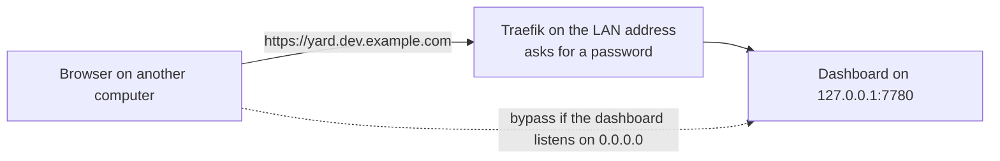

# Open the dashboard to your LAN with a password

<!-- base-domain: off -->

"I want to open the dashboard from another computer, but it has no login."

`yard.dev.example.com` asks for a password. The dashboard still listens on `127.0.0.1`. Traefik listens on the LAN address, and it checks the password.

!!! warning "Anything that runs on the Workstation still reaches the dashboard without a password"

    The password protects the hostname only. A program on the Workstation, or a container with host networking, opens `127.0.0.1:7780` directly. Anyone who opens the dashboard can change your Services and reach your containers through the Docker socket. Use this recipe on a LAN that you trust. Read [SECURITY.md](https://github.com/ppalazon/lvh-yard/blob/main/SECURITY.md) first.



## Before you start

You need:

- A running Workstation. `lvh-yard status` starts with `LVH Yard on this Workstation: ok`.
- A domain that you own, with a wildcard record that points to the LAN address of the Workstation. The examples use `*.dev.example.com` and the address `192.168.1.20`. `lvh.me` and `l.lvhy.cc` point to `127.0.0.1`, so another computer cannot use them. See [Pick your Base Domain](../../start/pick-your-base-domain.md).
- HTTPS, with a certificate that the other computer trusts. See [Test HTTPS with your Workstation CA](workstation-ca.md) or [Use a real certificate on your own domain](real-certificate.md).
- A tool that makes a bcrypt hash of a password, such as `htpasswd`.

For a server that the internet reaches, see [Run on a public server (not tested)](../../advanced/compose-consul-traefik.md#run-on-a-public-server-not-tested).

## CLI Steps

1. Make the hash of the password. The profile holds the hash, not the password.

    ```sh
    htpasswd -nbB admin <password>
    ```

2. Save a basic-auth Route Profile. Write this in `profiles.yaml`, with your hash:

    ```yaml
    http:
      middlewares:
        basic-auth:
          basicAuth:
            users:
              - "admin:$2y$05$..."
    ```

    ```sh
    lvh-yard profiles set profiles.yaml
    ```

    ```text
    Saved the Route Profile basic-auth.
    ```

3. Publish the Service `yard`, the dashboard, with the profile. After the first setup, `yard` is an ordinary Service, so a profile applies to it.

    ```sh
    lvh-yard publish yard --profile basic-auth
    ```

    ```text
    Published yard at yard.dev.example.com.
      Scope: Local
      State: healthy
      Route Profiles: basic-auth
    risk: [Authenticated Route] The Route Profile basic-auth asks who the user is only on the hostname. A direct connection to 127.0.0.1:7780 skips it. Make the Service check its users.
    ```

4. Make Traefik listen on the LAN address, and keep the dashboard on `127.0.0.1`.

    !!! warning "Traefik stops listening on 127.0.0.1"

        A name that points to `127.0.0.1` stops working on this Workstation. Use your own domain, which points to the LAN address. The dashboard stays at `http://127.0.0.1:7780`.

    ```sh
    lvh-yard ws set traefik-bind-address 192.168.1.20
    lvh-yard ws set dashboard-bind-address 127.0.0.1
    lvh-yard ws compose recreate
    ```

5. Open `https://yard.dev.example.com` in the browser of another computer. It asks for a user and a password. Use HTTPS only. The Route also answers on `http`, but basic auth sends the password readable there ([RFC 7617](https://www.rfc-editor.org/rfc/rfc7617)), and anyone on the LAN can read it.

## Dashboard Steps

- The dashboard has no form for the bind addresses. Use the CLI Steps.
- Open `http://yard.<Base Domain>` or [`http://127.0.0.1:7780`](http://127.0.0.1:7780). The second address works even when Traefik does not listen on loopback.
- Open `Route Profiles` and click `New Route Profile`. The `Examples` sidebar has `Basic auth`. Copy it into `Route options`, put your hash in it, and save it.
- Click `yard` on the `Catalog` page. In the `Route Profiles` card, choose the profile in `Route Profile to add` and click `Add`.
- Follow the forms.

## Check

Ask for the hostname without a password. `--resolve` sends the request to the LAN address, so the check works before your DNS has the record:

```sh
curl -sI --resolve yard.dev.example.com:443:192.168.1.20 https://yard.dev.example.com
```

```text
HTTP/2 401
```

The dashboard port must not answer on the LAN address. The command prints `000` when the connection fails:

```sh
curl -s -o /dev/null -w '%{http_code}\n' http://192.168.1.20:7780
```

```text
000
```

`lvh-yard test` sees the password too:

```sh
lvh-yard test yard
```

```text
Reachability of yard on ws-a, from this Workstation:
  ok    Instance 127.0.0.1:7780 (in the Route)
  ok    Route http://yard.dev.example.com: answered 401
  ok    Route https://yard.dev.example.com: answered 401
The Route uses the static Instance Source 52ff845b-d5eb-42eb-9e65-253a562575bf now.
Every check passed.
```

## Undo

Take the profile off the Service, and make Traefik listen on loopback again:

```sh
lvh-yard publish yard --no-profiles
lvh-yard ws set traefik-bind-address 127.0.0.1
lvh-yard ws compose recreate
```

## Troubleshooting

### `Connection refused` on `127.0.0.1` or `lvh.me`

Traefik listens on the LAN address only. A name that points to `127.0.0.1` gets no answer, and `curl` prints `curl: (7) Failed to connect to yard.dev.example.com:80 after 0 ms: Could not connect to server`. Use your own domain, or open the dashboard at `http://127.0.0.1:7780`.

### The dashboard opens without a password

The dashboard listens on every address, so a browser can open its port and skip the Route. `YARD_DASHBOARD_BIND_ADDRESS=0.0.0.0` does this. The port answers on the LAN address:

```sh
curl -s -o /dev/null -w '%{http_code}\n' http://192.168.1.20:7780
```

```text
200
```

Make the dashboard listen on loopback again, and apply the change:

```sh
lvh-yard ws set dashboard-bind-address 127.0.0.1
lvh-yard ws compose recreate
```
