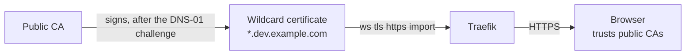

# Use a real certificate on your own domain

<!-- base-domain: off -->

"I own a domain, and I want HTTPS with no CA to install."

Traefik serves a public certificate for `*.dev.example.com`. Every browser
trusts it.



## Before you start

You need:

- A running Workstation. `lvh-yard status` starts with
  `LVH Yard on this Workstation: ok`.
- A Base Domain below a domain that you own, such as `dev.example.com`, with
  the wildcard DNS record `*.dev.example.com A 127.0.0.1`. See
  [Your own wildcard domain](../../start/pick-your-base-domain.md#your-own-wildcard-domain)
  and
  [Change the Base Domain](../../start/pick-your-base-domain.md#change-the-base-domain).
- A service with a hostname. The examples use `app`, as in
  [Your first Service](../../start/first-service.md).
- A tool that gets a wildcard certificate for your domain. This page does not
  teach one. Use the tool of your DNS provider or an ACME client.

## CLI Steps

1.  Get a wildcard certificate for `*.dev.example.com`. A public CA checks a
    wildcard with a DNS-01 challenge. Your tool puts a TXT record under
    `_acme-challenge.dev.example.com` to prove that you own the domain. Save
    the certificate with its whole chain as `fullchain.pem`, and the key as
    `privkey.pem`.

    A wildcard covers one label, so `*.dev.example.com` does not cover
    `app.ws-b.dev.example.com`. If this Workstation serves the Routes of
    `ws-b`, ask for `*.ws-b.dev.example.com` in the same certificate.

2.  Import the certificate. The command checks that the key matches, that a
    public CA signed the certificate, and that the certificate names
    `yard.dev.example.com`. For a company CA, add `--ca` with its CA
    certificate.

    ```sh
    lvh-yard ws tls https import --cert fullchain.pem --key privkey.pem
    ```

3.  Apply the change.

    ```sh
    lvh-yard ws compose recreate
    ```

4.  Open `https://app.dev.example.com` in your browser. You install no CA.

A public certificate expires. Repeat steps 1 to 3 with the new files.

## Dashboard Steps

- The dashboard has no form to import a certificate. Use the CLI Steps.
- In `Catalog`, a lock next to a hostname opens its `https` address.

## Check

```sh
curl -sI https://app.dev.example.com | head -1
```

```text
HTTP/2 200
```

## Undo

`disable` keeps the files and turns HTTPS off.

```sh
lvh-yard ws tls https disable
lvh-yard ws compose recreate
```

## Troubleshooting

### `certificate is valid neither for the given CA nor for a public CA`

`lvh-yard ws tls https import` stops with this error:

```text
certificate is valid neither for the given CA nor for a public CA: x509: certificate signed by unknown authority
```

If a public CA did not sign the certificate, give the CA that signed it, and
put the whole chain in the `--cert` file:

```sh
lvh-yard ws tls https import --ca ca.crt --cert fullchain.pem --key privkey.pem
```

### `certificate needs yard.dev.example.com`

`lvh-yard ws tls https import` stops with this error:

```text
certificate needs yard.dev.example.com, the address of the Yard Route: x509: certificate is valid for *.example.test, not yard.dev.example.com
```

The certificate does not name a hostname below the Base Domain of this
Workstation. Get a certificate for `*.dev.example.com`, or change the Base
Domain.

### `private key does not match public key`

`lvh-yard ws tls https import` stops with this error:

```text
certificate and key do not match or are invalid: tls: private key does not match public key
```

`--key` names the key of another certificate. Use the key that your tool made
with this certificate.
