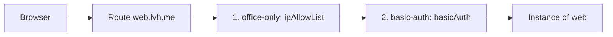

# Protect a dev service with Route Profiles

"I want a password, an IP allow list or CORS headers on a service, and I do not want to touch its code."

A Route Profile adds a Traefik middleware to the Route of a Service. You write it once, and each Publication names the profiles that it uses.



## Before you start

You need:

- A running Workstation. `lvh-yard status` starts with `LVH Yard on this Workstation: ok`.
- A Base Domain. See [Pick your Base Domain](../../start/pick-your-base-domain.md). The examples use `lvh.me`.
- Two published Services. `web` is a Static Instance at `127.0.0.1:4000`, and `api` is one at `127.0.0.1:4001`. See [Your first Service](../../start/first-service.md).
- A tool that makes a bcrypt hash of a password, such as `htpasswd`.

## CLI Steps

1. Make the hash of a password for basic auth. The profile holds the hash, not the password.

    ```sh
    htpasswd -nbB ana <password>
    ```

    ```text
    ana:$2y$05$MqmyMWmK4RdSVUn9MrcYmO2Vb8YpmuUQDlTzqMcUIxlaVejn7lAz2
    ```

2. Write the profiles in the format of Traefik. This file has three profiles. `office-only` allows your own computer and the LAN. `basic-auth` asks for the user `ana`. `cors` allows one origin.

    ```yaml
    http:
      middlewares:
        office-only:
          ipAllowList:
            sourceRange:
              - 127.0.0.1/32
              - 192.168.1.0/24
        basic-auth:
          basicAuth:
            users:
              - "ana:$2y$05$MqmyMWmK4RdSVUn9MrcYmO2Vb8YpmuUQDlTzqMcUIxlaVejn7lAz2"
        cors:
          headers:
            accessControlAllowOriginList:
              - http://localhost:5173
            accessControlAllowMethods:
              - GET
              - POST
            accessControlAllowHeaders:
              - Content-Type
    ```

3. Save the file as `profiles.yaml`. Then save the profiles. A profile that has the name of an existing one replaces it.

    ```sh
    lvh-yard profiles set profiles.yaml
    ```

    ```text
    Saved the Route Profiles office-only, basic-auth, cors.
    ```

4. List the profiles. No Service uses them yet.

    ```sh
    lvh-yard profiles
    ```

    ```text
    basic-auth: basicAuth, not used
    cors: headers, not used
    office-only: ipAllowList, not used
    ```

5. Publish `web` with two profiles, and `api` with one. The Route applies the profiles in the order of the flags.

    !!! warning "A profile protects the hostname, not the port"

        A connection straight to `127.0.0.1:4000` does not go through Traefik, so it skips the profile. Anyone who reaches that port needs no password. Make the Service check its users, or keep its port private.

    ```sh
    lvh-yard publish web --profile office-only --profile basic-auth
    lvh-yard publish api --profile cors
    ```

    ```text
    Published web at web.lvh.me.
      Scope: Local
      State: healthy
      Route Profiles: office-only, basic-auth
    risk: [Authenticated Route] The Route Profile basic-auth asks who the user is only on the hostname. A direct connection to 127.0.0.1:4000 skips it. Make the Service check its users.
    Published api at api.lvh.me.
      Scope: Local
      State: unhealthy
      Route Profiles: cors
    ```

    Open `http://web.lvh.me` in your browser. It asks for a user and a password. `http://api.lvh.me` answers with the CORS headers for the allowed origin.

## Dashboard Steps

- Open `http://yard.<Base Domain>` or [`http://127.0.0.1:7780`](http://127.0.0.1:7780).
- Open `Route Profiles` and click `New Route Profile`. Type a name, write the options as YAML in `Route options`, and click `Save Route Profile`.
- The `Examples` sidebar has a profile for each common case, such as `Basic auth`, `IP allow list` and `CORS`. Copy one into `Route options` and change its values.
- Click `Change` in a row to edit a profile. If you save a name that exists, the new profile replaces it for every Service that uses it.
- Click a Service on the `Catalog` page. In the `Route Profiles` card, choose a profile in `Route Profile to add` and click `Add`.
- The icons at the right of a profile in that card change its order. The red cross takes it off the Service. It does not delete the profile.
- Follow the forms.

## Check

`lvh-yard profiles` shows the Services that use each profile:

```sh
lvh-yard profiles
```

```text
basic-auth: basicAuth, used by web
cors: headers, used by api
office-only: ipAllowList, used by web
```

`web` answers `401` until the request carries the password:

```sh
curl -sI http://web.lvh.me
```

```text
HTTP/1.1 401 Unauthorized
```

(The command prints more lines. This is the first.)

`api` adds the CORS headers when the request names the allowed origin. The preflight request of a browser gets the allowed methods and headers:

```sh
curl -si -X OPTIONS -H 'Origin: http://localhost:5173' -H 'Access-Control-Request-Method: POST' http://api.lvh.me
```

```text
HTTP/1.1 200 OK
Access-Control-Allow-Headers: Content-Type
Access-Control-Allow-Methods: GET,POST
Access-Control-Allow-Origin: http://localhost:5173
Content-Length: 0
```

## Undo

Take the profiles off the Service. The Route sends the requests unchanged:

```sh
lvh-yard publish web --no-profiles
```

The command refuses to remove a profile that a Publication uses. Take it off first. Then remove it:

```sh
lvh-yard profiles remove office-only
```

## Troubleshooting

### `403 Forbidden`

The IP allow list refuses your address. Traefik sees a request from your own computer as `127.0.0.1`, not as the address of your LAN. With only `192.168.1.0/24` in `sourceRange`, the hostname answers:

```text
HTTP/1.1 403 Forbidden
```

Change the profile and add your address. This command opens the profile in your editor, and the Routes use the new value after a few seconds:

```sh
lvh-yard profiles edit office-only
```

### `No Route Profile is named team-login.`

`lvh-yard publish` refuses a name that is not a profile of this Workstation, and it lists the names that exist:

```text
No Route Profile is named team-login. The profiles are: basic-auth, cors, office-only.
```

Save the profile with `lvh-yard profiles set`, or correct the name.

### `cors is in use, so it cannot be removed.`

`lvh-yard profiles remove` refuses a profile that a Publication names, and it lists the Services:

```text
cors is in use, so it cannot be removed. The Publications of these Services name it: api.
```

Take the profile off those Services first. See [Undo](#undo).

### The browser blocks my request with a CORS error

The response has no `Access-Control-Allow-Origin` header when the origin is not in `accessControlAllowOriginList`. The origin of the browser must match an entry exactly, with its scheme, its host and its port. With the profile above, the origin `http://evil.example` gets a response without the header:

```sh
curl -si -H 'Origin: http://evil.example' http://api.lvh.me | grep -i access-control
```

The command prints nothing. Add the origin of your front end to `accessControlAllowOriginList`, and save the profile again.
