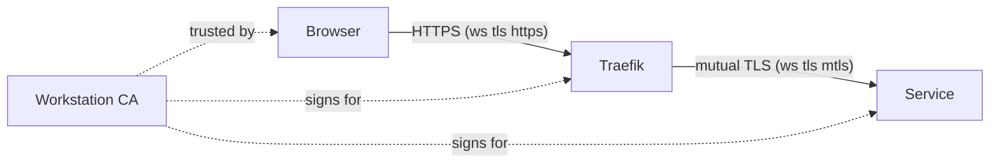

# Test HTTPS with your Workstation CA

"I need HTTPS in development, and I do not want to click through a browser
warning."

Traefik serves HTTPS with a certificate that your Workstation CA signs. Your
browser trusts that CA.



## Before you start

You need:

- A running Workstation. `lvh-yard status` starts with
  `LVH Yard on this Workstation: ok`.
- A Base Domain. See
  [Pick your Base Domain](../../start/pick-your-base-domain.md). The examples
  use `lvh.me`.
- A Service with an Instance. The examples use `app`, as in
  [Your first Service](../../start/first-service.md).

## CLI Steps

### HTTPS for your browser

1.  Make the Workstation CA. The command asks for the name of the CA and for a
    password for `ca.key`. Without a terminal, it uses the defaults.

    ```sh
    lvh-yard ws tls ca create
    ```

2.  Sign the HTTPS certificate of this Workstation. It names `*.lvh.me`,
    `localhost` and `127.0.0.1`. A wildcard covers one label. For
    `app.ws-b.lvh.me`, add `--address '*.ws-b.lvh.me'`.

    ```sh
    lvh-yard ws tls https create
    ```

    ```text
    HTTPS certificate for ws-a signed.
      Names: DNS:*.lvh.me, DNS:localhost, IP:127.0.0.1
    ```

3.  Apply the change.

    ```sh
    lvh-yard ws compose recreate
    ```

4.  Trust the CA in your browser.

    !!! warning "A browser that trusts the CA trusts everything that it signs"

        Import only `ca.crt`, never `ca.key`. The browser then trusts every certificate that this CA signs, for any name. The key is a file on this computer, and nothing can revoke a certificate that it signed. For more than testing, use a company CA or a public CA.

    === "Linux and macOS"

        Import `~/.config/lvh-yard/ca/ca.crt` as a trusted certificate authority for websites. Use the certificate settings of your browser, or the trust store of your operating system. Firefox has its own store: use the Authorities tab of its certificate manager.

    === "Windows"

        Import the CA into the certificate store of your user. It needs no administrator rights, and it needs a desktop session.

        ```powershell
        $ws = "$env:LOCALAPPDATA\lvh-yard\workstation"
        Import-Certificate -FilePath "$ws\ca\ca.crt" -CertStoreLocation Cert:\CurrentUser\Root
        ```

        Firefox has its own store: use the Authorities tab of its certificate manager.

5.  Open `https://app.lvh.me` in your browser. HTTPS uses port 443 until you
    set another port with `lvh-yard ws set https-port`. The hostname with
    `http` keeps working.

### HTTPS to a Service

Traefik calls a Service over plain HTTP by default. A Service with TLS of its
own needs mutual TLS (mTLS). Traefik then shows its certificate to the Service,
and it checks the certificate of the Service.

1. Sign a certificate for Traefik to use with Services. It also makes the CA
   the one that checks the Services.

    ```sh
    lvh-yard ws tls mtls create
    ```

2. Apply the change.

    ```sh
    lvh-yard ws compose recreate
    ```

3. Sign a certificate for the Service. The command asks for a password for the
   zip file that it writes.

    ```sh
    lvh-yard ws tls ca issue service app
    ```

4. Configure the TLS Listening port in the Service giving the certificates
   `service-fullchain.crt` and `service.key`. Remember that the Service must
   trust `ca/ca.crt` and ask for a client certificate (Traefik).

5. Enable mutual TLS for the Service.

    ```sh
    lvh-yard publish app --mutual-tls on
    ```

## Dashboard Steps

- The dashboard has no form to make a CA or a certificate. Use the CLI Steps.
- In `Catalog`, a lock next to a hostname opens its `https` address.
- On the page of a Service, switch `Mutual TLS to the Instances` on.
- Follow the forms.

## Check

Ask for the headers of the Route. `--cacert` names the CA for this one request:

=== "Linux and macOS"

    ```sh
    curl -sI --cacert ~/.config/lvh-yard/ca/ca.crt https://app.lvh.me | head -1
    ```

=== "Windows"

    ```powershell
    curl.exe -sI --ssl-no-revoke --cacert "$ws\ca\ca.crt" https://app.lvh.me
    ```

```text
HTTP/2 200
```

For a Service with mutual TLS, test the Route:

```sh
lvh-yard test app
```

```text
Reachability of app on ws-a, from this Workstation:
  ok    Instance 127.0.0.1:4000 (in the Route)
  ok    Route http://app.lvh.me: answered 200
  ok    Route https://app.lvh.me: answered 200
```

## Undo

`disable` keeps the certificates and turns the part off. To remove the trust
from your browser, remove the CA from the store where you imported it.

```sh
lvh-yard publish app --mutual-tls off
lvh-yard ws tls mtls disable
lvh-yard ws tls https disable
lvh-yard ws compose recreate
```

## Troubleshooting

### `unable to get local issuer certificate`

`curl` stops with this error, or the browser shows a warning:

```text
curl: (60) SSL certificate OpenSSL verify result: unable to get local issuer certificate (20)
```

The client does not trust the Workstation CA. Name `ca.crt` with `--cacert` for
one request, or import it as in step 4.

### `502 Bad Gateway`

The Route answers `502` over HTTP and over HTTPS, and the Service speaks TLS
only. Traefik calls the Service over plain HTTP, and the Service refuses it.
Enable mutual TLS for the Service:

```sh
lvh-yard publish app --mutual-tls on
```
