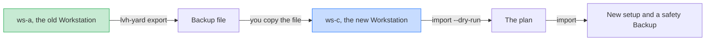

# Move or copy a setup with a Backup

"I got a new laptop, or I want my teammate to have my setup."

You export a Backup of the old Workstation, read the plan on the new one, and import it. The new Workstation gets your setup.



## Before you start

You need:

- **ws-a**{.ws-a} The old Workstation, with the setup that you want to move.
- **ws-c**{.ws-c} A new Workstation. `lvh-yard status` starts with `LVH Yard on this Workstation: ok`. See [Install LVH Yard](../../start/install.md).
- A way to copy a file between the two computers.

A Backup holds:

- The Services that you made, empty ones too.
- The Publication of each Service: its Scope, its Route Profiles, its access log setting and its mutual TLS setting.
    - An Unpublished Service has none.
- The Instance Priority of each Service, on or off.
- The Instance Sources of each Service, in their order:
    - Static Instances, with their port, host, health check, tags and meta. A host that is the address of the old Workstation is left out.
    - Container Bindings, to a container or to a Compose service, with the Container Port.
    - Aliases, with the Remote Service and its Workstation.
- The Route Profiles (include basic-auth hashes).
- The name of the old Workstation and the time of the export.

A Backup never holds:

- Certificates and keys: the Workstation CA, the certificates of HTTPS, of mutual TLS and of Services, and the Client Certificates.
- The settings of the Workstation in `.env`, such as the Base Domain, the ports and the bind addresses.
- The Compose files and the Consul data.
- The membership of a Yard: the Peers, the Gossip Key and the Invitations.
- The containers, their images and the processes of your Static Instances.

The examples use **ws-a**{.ws-a} as the old Workstation and **ws-c**{.ws-c} as the new one. **ws-a**{.ws-a} has three Services that you made. `web` has a Static Instance on port 4000 and the Route Profile `team-login`. `mailpit` has a Container Binding to `mailpit-1`. `notes` is empty.

On **ws-c**{.ws-c}, start the containers and the processes of your Services. Sign the certificates of **ws-c**{.ws-c} again.

## CLI Steps

**ws-a**{.ws-a} is the old Workstation, and **ws-c**{.ws-c} is the new one.

!!! warning "A Backup holds the basic-auth hashes of your Route Profiles"

    Anyone who can read the file can read them. Keep a Backup as private as a password file. `lvh-yard export -o` writes a file that only you can read. Copy it only in a way that keeps it private.

1. **ws-a**{.ws-a} Write the Backup to a file.

    ```sh
    lvh-yard export -o ws-a.yaml
    ```

    The file lists the Route Profiles and the Services:

    ```yaml
    version: 3
    exported-from:
      workstation: ws-a
    route-profiles:
      team-login:
        basicAuth:
          users:
            - ana:$apr1$K8Q9b0vY$ed0TaM7pstquCpuNXjtsD/
    services:
      web:
        publication:
          scope: local
          route-profiles:
            - team-login
        instance-priority: true
        sources:
          - static-instance:
              port: 4000
    ```

2. Copy `ws-a.yaml` to the computer of **ws-c**{.ws-c}, for example with `scp`.

3. **ws-c**{.ws-c} Read the plan. Nothing changes.

    ```sh
    lvh-yard import --dry-run ws-a.yaml
    ```

    ```text
    add Route Profile team-login
    skip Service consul-ui: It exists already.
    ...
    add Service mailpit
    add Container Binding mailpit-1:8025 of mailpit
    add Publication of mailpit
    add Service notes
    skip Publication of notes: It is Unpublished already.
    ...
    add Service web
    add Static Instance 127.0.0.1:4000 of web
    add Publication of web
    ...
    Dry run: nothing changed.
    ```

    **ws-c**{.ws-c} has `consul-ui`, `traefik-admin` and `yard` already, so the plan skips them.

4. **ws-c**{.ws-c} Import the Backup. The import adds what is new and skips what exists.

    ```sh
    lvh-yard import ws-a.yaml
    ```

    ```text
    Added 8, skipped 13.
    Safety Backup: ws-c-20261123-174019-before-import.yaml, in the Backups folder.
    ```

    The command prints the whole plan before these two lines. The safety Backup is a Backup of the setup of **ws-c**{.ws-c} before the import.

5. **ws-c**{.ws-c} A Service that exists on **ws-c**{.ws-c} keeps its values. To overwrite them with the values of the Backup, add `--update`.

    ```sh
    lvh-yard import --update ws-a.yaml
    ```

    A skip of a value that differs becomes an update. For example, **ws-c**{.ws-c} has `web` with no Route Profile:

    ```text
    update Publication of web
    Added 0, updated 1, skipped 23.
    ```

**ws-c**{.ws-c} `lvh-yard import -` reads the Backup from the standard input. So you can skip the file and pipe it from the other computer:

```sh
ssh old-laptop lvh-yard export | lvh-yard import -
```

## Dashboard Steps

- Open `http://yard.<Base Domain>` or [`http://127.0.0.1:7780`](http://127.0.0.1:7780), and open `Backups`.
- **ws-a**{.ws-a} Click `New Backup`, then click `Download` in its row.
- **ws-c**{.ws-c} Click `Upload a Backup`, choose the file, and click `Upload`.
- **ws-c**{.ws-c} Click `Import` in the row of the file. Choose `Add` or `Update`, and click `Show the plan`.
- **ws-c**{.ws-c} The plan lists what changes and what it skips. Click `Import`. The page names the safety Backup.
- Follow the forms.

## Check

**ws-c**{.ws-c} `lvh-yard catalog` lists the Services of the Backup:

```sh
lvh-yard catalog
```

```text
ws-c (this Workstation)
  consul-ui      healthy      local  consul-ui.lvh.me      1/1  [static]
  mailpit        healthy      local  mailpit.lvh.me        1/1  [docker]
  notes          unpublished                               Empty
  traefik-admin  healthy      local  traefik-admin.lvh.me  1/1  [static]
  web            healthy      local  web.lvh.me            1/1  [static]
  yard           healthy      local  yard.lvh.me           1/1  [static]
```

A Service is `healthy` when its container or its process runs on the new computer. The Route Profile came with the Backup. `web` asks for a password:

```sh
curl -sI http://web.lvh.me
```

```text
HTTP/1.1 401 Unauthorized
```

(The command prints more lines. This is the first.)

## Undo

**ws-c**{.ws-c} An import never removes what it added. Remove the Services that you do not want:

```sh
lvh-yard service delete notes
```

To get back the values that `--update` overwrote, import the safety Backup with `--update`. Use the name that the import printed:

```sh
lvh-yard import --update ws-c-20261123-174033-before-import.yaml
```

The Backups folder is `backups/` in the Workstation Folder. The dashboard never deletes its files.

## Troubleshooting

### The import refuses the Backup

The command prints each problem with its place and its reason, and exits with 1. It changes nothing, because it checks the whole file first:

```text
services.web.sources[0].static-instance.port: The port 70000 is not a TCP port: use 1 to 65535.
```

A Publication can name only a Route Profile that the file holds or that the new Workstation has:

```text
services.web.publication.route-profiles[0]: The Route Profile login is not in the file, and this Workstation does not have it.
```

Correct the file at the place that the line names, and import again.

### `skip Service web: It exists already.`

The new Workstation has the Service, so the import skips it and keeps your values. Read the plan with `--dry-run`. To overwrite what exists, import with `--update`.

### A Service of the Workstation is `degraded` after the import

The Backup holds `yard`, `consul-ui` and `traefik-admin`, the Services of the old Workstation, with their ports. With other ports, the import adds the Static Instances of the old ports to the Services of the new Workstation. Nothing listens there, so the Instances are `critical`:

```text
  yard: degraded at yard.lvh.me
    Instance Priority: on
      1. 4f117f6f-0ace-4d52-a0d4-247ea733c909  Static Instance 127.0.0.1:20780  (in use)
      2. b3ca5ea1-2567-49d8-90aa-64ef34143f01  Static Instance 127.0.0.1:19780
    127.0.0.1:19780  critical  b3ca5ea1-2567-49d8-90aa-64ef34143f01
    127.0.0.1:20780  passing   4f117f6f-0ace-4d52-a0d4-247ea733c909  routed
```

Here the old dashboard used port 19780, and the new one uses port 20780. The Route still works, because it uses the Instance that passes. Remove the Instance of the old port:

```sh
lvh-yard remove yard --host 127.0.0.1 --port 19780
```
