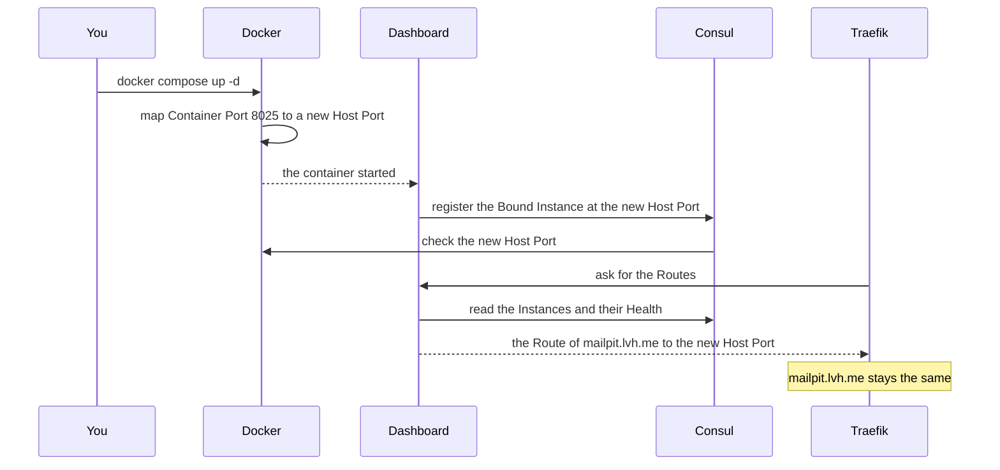

# Stop chasing Compose ports

"Docker gives my container a new port after every `compose up`."

You bind the Compose service once. The hostname stays the same, whatever Host Port Docker gives.

[Your first Service](../../start/first-service.md) binds one container by its name. This recipe binds the Compose service. The binding survives `docker compose down` and follows every container of the service.



## Before you start

You need:

- A running Workstation. `lvh-yard status` starts with `LVH Yard on this Workstation: ok`.
- A Base Domain. See [Pick your Base Domain](../../start/pick-your-base-domain.md). The examples use `lvh.me`.
- A Compose service that publishes its port with no Host Port, so that Docker chooses it.

## CLI Steps

1. Start a Compose project where Docker chooses the Host Port. The entry `"8025"` in `ports` has no Host Port. The project is `demo`, and its service is `mailpit`.

    ```yaml
    name: demo
    services:
      mailpit:
        image: axllent/mailpit
        ports:
          - "8025"
    ```

    ```sh
    docker compose up -d
    ```

2. Find the project, the service and the Container Port. `Unfollowed` marks a container that no Container Binding follows.

    ```sh
    lvh-yard containers --details
    ```

    ```text
    Compose project demo
      mailpit: 1 container; 1025, 1110, 8025; Unfollowed: demo-mailpit-1
        demo-mailpit-1: 1025 not published, 1110 not published, 0.0.0.0:33680->8025, [::]:33680->8025; running; Unfollowed; healthy
    ```

    The list has one group for each Compose project. Find yours. You can bind any Container Port of the service. The port decides who can open the hostname.

    | Container Port | Host Port | Bound Instance at                    | Other Workstations (Yard Scope)          |
    | -------------- | --------- | ------------------------------------ | ---------------------------------------- |
    | `8025`         | `33680`   | `127.0.0.1:33680`                    | Reach it.                                |
    | `1025`, `1110` | none      | Container address and Container Port | Cannot reach it. The Service page warns. |

    Local Scope: only this Workstation opens the hostname. Yard Scope: every Workstation of your Yard opens it. This recipe binds port 8025, so you can share it later.

3. Create the Service.

    ```sh
    lvh-yard service create mailpit
    ```

4. Bind the Compose service by its project, its service and the Container Port. Without `--service`, the Service has the cleaned name of the Compose service.

    ```sh
    lvh-yard register compose demo/mailpit --port 8025
    ```

5. Publish the Service.

    ```sh
    lvh-yard publish mailpit
    ```

    Open `http://mailpit.lvh.me` in your browser.

## Dashboard Steps

- Open `http://yard.<Base Domain>` or [`http://127.0.0.1:7780`](http://127.0.0.1:7780).
- Open `Containers` in the navigation bar.
- Click `Create Service` on the line of port 8025 of the project `demo`.
- Leave `Publish` checked and `Scope` on `Local`.
- Click `Create Service`. The page of the new Service opens.
- Follow the forms for anything else.

## Check

Read the Host Port that Docker chose:

```sh
docker compose port mailpit 8025
```

```text
0.0.0.0:33680
```

Ask for the headers of the hostname with `curl`. Traefik needs a few seconds to pick up the Instance. Until then, it answers `502`.

```sh
curl -sI http://mailpit.lvh.me | head -1
```

```text
HTTP/1.1 200 OK
```

Recreate the container. Docker chooses another Host Port:

```sh
docker compose down
docker compose up -d
docker compose port mailpit 8025
```

```text
0.0.0.0:33681
```

Wait a few seconds and open the hostname again, or run the same `curl` command. It prints `HTTP/1.1 200 OK` again. The hostname did not change.

The binding follows every container of the Compose service. Run `docker compose up -d --scale mailpit=2`. Then `lvh-yard catalog` shows `2/2` Instances for `mailpit`.

## Undo

`lvh-yard service delete` removes the Service with its Publication and its Container Binding. It leaves the containers running. `docker compose down` removes them.

```sh
lvh-yard service delete mailpit
docker compose down
```

## Troubleshooting

### `Connection refused`

The catalog shows `mailpit` as `unhealthy` with `0/1` Instances. The hostname answers `502 Bad Gateway`. `lvh-yard test mailpit` names the cause:

```text
Reachability of mailpit on ws-a, from this Workstation:
  FAIL  Instance 172.28.0.2:9999 (in the Route): Connection refused (connect failed)
  FAIL  Route http://mailpit.lvh.me: Traefik answered 502: no Instance answered.
No Instance passes. The Route uses every Instance in range.
2 of 2 checks failed.
```

The `--port` of `register compose` is not a Container Port of the service. The Instance is at the address of the container, on a port where nothing listens. Read the right port with `lvh-yard containers --details`. Remove the binding and bind again:

```sh
lvh-yard remove mailpit --compose-project demo --compose-service mailpit
lvh-yard register compose demo/mailpit --port 8025
```

### `No Instances`

The catalog shows `mailpit` as `unavailable` with `No Instances`. No container matches the binding. Either the Compose project does not run, or the project in the binding has a typo. `register compose` does not check the project. For a project that does not run, it answers `None of its containers runs now`.

Start the project with `docker compose up -d`. `lvh-yard containers --state all --followed all` lists every container with its project and service. If the project is wrong, remove the binding as above and bind again.

A wrong service name stops earlier. The default Service name is the cleaned name of the Compose service, so `register compose` asks you to create that Service first.

On Windows, a port that Docker publishes only on an IPv6 address also gives no Bound Instance.
