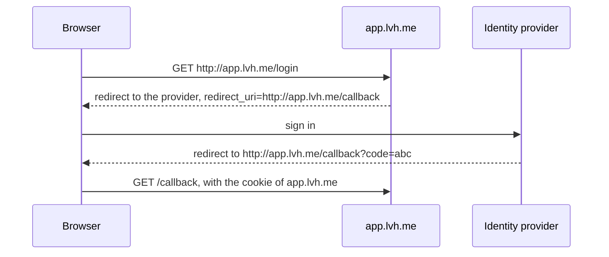

# Fix cookies and OAuth callbacks

"`localhost:3000` breaks my cookies and my OAuth callback. The identity provider wants a real hostname."

The app runs at `http://app.lvh.me`. Its cookies and its callback URL use that hostname.

A cookie ignores the port. Two apps at `localhost:3000` and `localhost:4000` send each other's cookies. Two hostnames keep them apart.



## Before you start

You need:

- A running Workstation. `lvh-yard status` starts with `LVH Yard on this Workstation: ok`.
- A Base Domain. See [Pick your Base Domain](../../start/pick-your-base-domain.md). The examples use `lvh.me`.
- An app that listens on a port and sets cookies. The examples use two copies of this script, saved as `app.py`. `/login` sets a cookie for one host and a cookie for every host of the Base Domain. Every path prints the host and the cookies that it received.

```python
import sys
from http.server import BaseHTTPRequestHandler, HTTPServer

name, port = sys.argv[1], int(sys.argv[2])


class Handler(BaseHTTPRequestHandler):
    def do_GET(self):
        self.send_response(200)
        if self.path == "/login":
            self.send_header("Set-Cookie", f"session={name}; Path=/")
            self.send_header("Set-Cookie", "sso=1; Domain=lvh.me; Path=/")
        self.send_header("Content-Type", "text/plain")
        self.end_headers()
        host = self.headers["Host"].split(":")[0]
        self.wfile.write(f"{name}: Host={host} Cookie={self.headers.get('Cookie')}\n".encode())

    def log_message(self, *args):
        pass


HTTPServer(("127.0.0.1", port), Handler).serve_forever()
```

## CLI Steps

1.  Start two copies of the app, each in its own terminal.

    ```sh
    python3 app.py app 4000
    python3 app.py api 4001
    ```

2.  Give each copy a Service, an Instance and a hostname.

    ```sh
    lvh-yard service create app
    lvh-yard register static app --host 127.0.0.1 --port 4000
    lvh-yard publish app
    lvh-yard service create api
    lvh-yard register static api --host 127.0.0.1 --port 4001
    lvh-yard publish api
    ```

    Open `http://app.lvh.me` and `http://api.lvh.me` in your browser. Traefik passes the `Host` header unchanged, so the app reads `app.lvh.me`. Build the callback URL from it.

3.  Give the callback URL to your identity provider: `http://app.lvh.me/callback`. If the provider needs HTTPS, see the recipe "Test HTTPS with your Workstation CA".

4.  Log in. The app sets two cookies. A cookie with no `Domain` goes to its own host only, here `app.lvh.me`. A cookie with `Domain=lvh.me` goes to every host below `lvh.me`.

    !!! warning "A cookie for a shared domain goes where the DNS points"

        A cookie with `Domain=lvh.me` goes to every hostname below `lvh.me`. The owner of a shared domain can point the names to another address. Then your browser sends the cookie there. Use a domain that you control for daily work. See [Pick your Base Domain](../../start/pick-your-base-domain.md).

    ```sh
    curl -s -c cookies.txt http://app.lvh.me/login
    ```

## Dashboard Steps

- Open `http://yard.<Base Domain>` or [`http://127.0.0.1:7780`](http://127.0.0.1:7780).
- Click `New Service` on the `Catalog` page.
- On the page of the Service, click `Add Static Instance`.
- Switch `Published` on.
- Follow the forms.

## Check

Send the cookies of step 4 to both hostnames:

```sh
curl -s -b cookies.txt http://app.lvh.me/
curl -s -b cookies.txt http://api.lvh.me/
```

```text
app: Host=app.lvh.me Cookie=session=app; sso=1
api: Host=api.lvh.me Cookie=sso=1
```

`session` has no `Domain`, so only `app.lvh.me` gets it. `sso` has `Domain=lvh.me`, so `api.lvh.me` gets it too.

## Undo

`lvh-yard service delete` removes a Service with its Publication and its Static Instances. It leaves the app running. Stop the apps with `Ctrl+C` in their terminals.

```sh
lvh-yard service delete app
lvh-yard service delete api
```

## Troubleshooting

### `404 page not found`

The app answers at `http://app.lvh.me`, but `http://acme.app.lvh.me` answers `404 page not found`:

```text
404 page not found
```

A Route answers for the hostname `<service>.<Base Domain>` only. A hostname with one more label has no Route, so a tenant subdomain such as `acme.app.lvh.me` does not work. Publish one Service for each hostname that you need, with the same Instance:

```sh
lvh-yard service create acme
lvh-yard register static acme --host 127.0.0.1 --port 4000
lvh-yard publish acme
```
