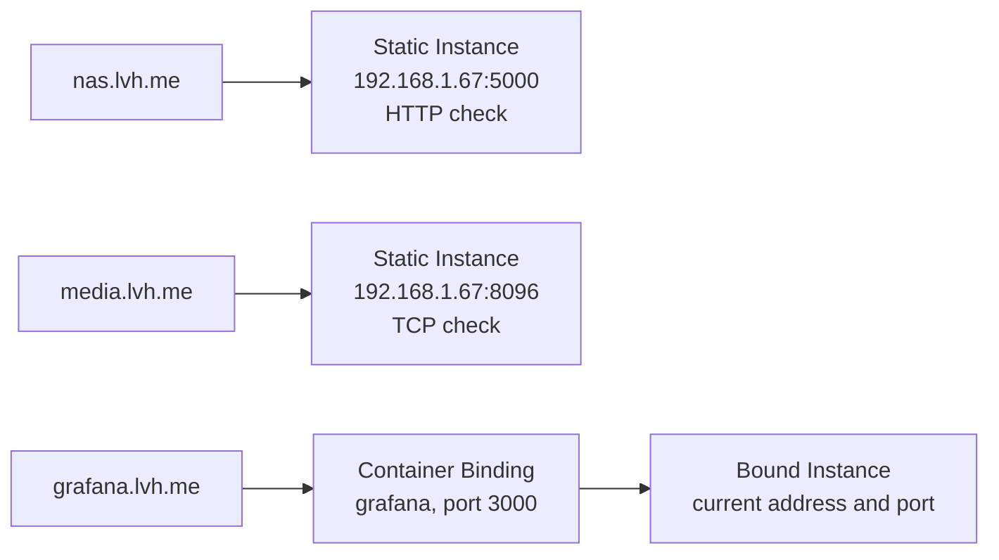

# Name every HomeLab service

"I have a NAS, a media server, a Grafana container and a dev process, and I remember none of the ports."

Each of them has a name, and `lvh-yard catalog` lists them all. A dev process joins the list as in [Your first Service](../../start/first-service.md).



## Before you start

You need:

- A running Workstation. `lvh-yard status` starts with `LVH Yard on this Workstation: ok`.
- A Base Domain. See [Pick your Base Domain](../../start/pick-your-base-domain.md). The examples use `lvh.me`.
- A device with a fixed address that answers plain HTTP. Traefik calls each Instance over plain HTTP. The examples use a NAS at `192.168.1.67:5000` and a media server at `192.168.1.67:8096`.
- A container. The examples use Grafana.

## CLI Steps

1. Start the container. Docker chooses the Host Port.

    ```sh
    docker run -d --name grafana -p 3000 grafana/grafana
    ```

2. List the containers that no Service follows. `Unfollowed` marks them.

    ```sh
    lvh-yard containers
    ```

    ```text
    Other containers
      grafana: 1 container; 3000; Unfollowed: grafana
    ```

    Your list has more groups. Find your container.

3. Create one Service for each thing.

    ```sh
    lvh-yard service create nas
    lvh-yard service create media
    lvh-yard service create grafana
    ```

4. Register the NAS. Its web page answers `200` on `/`, so use an HTTP check. An HTTP check passes on a `2xx` answer.

    ```sh
    lvh-yard register static nas --host 192.168.1.67 --port 5000 --check http --path /
    ```

5. Register the media server. The default check is TCP. It connects to the port.

    ```sh
    lvh-yard register static media --host 192.168.1.67 --port 8096
    ```

6. Follow the container. The Service has the name of the container.

    ```sh
    lvh-yard register container grafana --port 3000
    ```

7. Publish the three Services.

    ```sh
    lvh-yard publish nas
    lvh-yard publish media
    lvh-yard publish grafana
    ```

    Open `http://nas.lvh.me`, `http://media.lvh.me` and `http://grafana.lvh.me` in your browser.

## Dashboard Steps

- Open `http://yard.<Base Domain>` or [`http://127.0.0.1:7780`](http://127.0.0.1:7780).
- Click `New Service` on the `Catalog` page.
- On the page of the Service, click `Add Static Instance` for a device or `Bind container` for a container.
- Switch `Published` on.
- Open `Containers` to see the containers with no Service. Click `Create Service` on a port.
- Follow the forms.

## Check

```sh
lvh-yard catalog
```

```text
ws-a (this Workstation)
  consul-ui      healthy  local  consul-ui.lvh.me      1/1  [static]
  grafana        healthy  local  grafana.lvh.me        1/1  [docker]
  media          healthy  local  media.lvh.me          1/1  [static]
  nas            healthy  local  nas.lvh.me            1/1  [static]
  traefik-admin  healthy  local  traefik-admin.lvh.me  1/1  [static]
  yard           healthy  local  yard.lvh.me           1/1  [static]
```

The three new Services are `healthy`. `lvh-yard catalog --details` adds the address and the Health of each Instance.

## Undo

`lvh-yard service delete` removes a Service with its Publication, Static Instances and Container Bindings. It leaves the container running. `docker rm -f` removes the container.

```sh
lvh-yard service delete nas
lvh-yard service delete media
lvh-yard service delete grafana
docker rm -f grafana
```

## Troubleshooting

### `Connection refused`

The catalog shows the Service as `unhealthy` with `0/1` Instances. The device answers, but nothing listens at that port. The program on the device stopped, or the port is wrong. `lvh-yard test media` names the cause:

```text
Reachability of media on ws-a, from this Workstation:
  FAIL  Instance 192.168.1.67:8096 (in the Route): Connection refused (connect failed)
  FAIL  Route http://media.lvh.me: Traefik answered 502: no Instance answered.
No Instance passes. The Route uses every Instance in range.
2 of 2 checks failed.
```

Start the program, or remove the Instance and register it again with the right port:

```sh
lvh-yard remove media --port 8096
lvh-yard register static media --host 192.168.1.67 --port 8096
```

### `No answer within 2 s`

The catalog shows the Service as `unhealthy` with `0/1` Instances. The device does not answer at that address. It is off, the address has a typo, or a firewall drops the connection. `lvh-yard test media` names the cause:

```text
Reachability of media on ws-a, from this Workstation:
  FAIL  Instance 192.168.1.250:8096 (in the Route): No answer within 2 s: a firewall may drop the connection.
  FAIL  Route http://media.lvh.me: Traefik answered 502: no Instance answered.
No Instance passes. The Route uses every Instance in range.
2 of 2 checks failed.
```

Check the address from this computer, then remove the Instance and register it again:

```sh
lvh-yard remove media --host 192.168.1.250 --port 8096
lvh-yard register static media --host 192.168.1.67 --port 8096
```

### `Every check passed`

The catalog shows the Service as `unhealthy`, and `lvh-yard test nas` says that every check passed. The Route answers, but the HTTP check of the Instance does not pass. An HTTP check wants a `2xx` answer, and this device answers `302` on `/`, the redirect to its login page:

```text
Reachability of nas on ws-a, from this Workstation:
  ok    Instance 192.168.1.67:5002 (in the Route)
  ok    Route http://nas.lvh.me: answered 302
No Instance passes. The Route uses every Instance in range.
Every check passed.
```

Register the Instance with the default TCP check, or give `--path` a path that answers `2xx`:

```sh
lvh-yard remove nas --port 5002
lvh-yard register static nas --host 192.168.1.67 --port 5002
```
