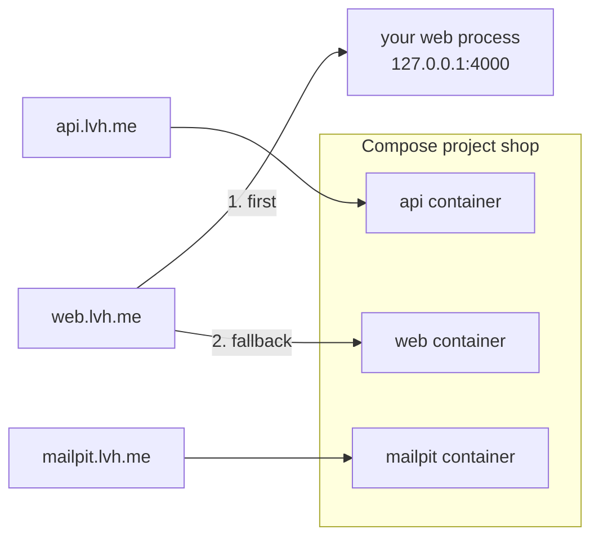

# Develop one service, keep the rest in Docker

"I run `web` as a process with hot reload, and the rest of my Compose stack runs in Docker. I want one name for each service."

You bind every service of the stack once. Then you run `web` as a process and put it first. `web.lvh.me` goes to your process while it runs, and to the container when it does not. `api.lvh.me` and `mailpit.lvh.me` follow their containers.

[Stop chasing Compose ports](compose-ports.md) binds a Compose service. [Put your process before the container](../choose/instance-priority.md) puts a process first. This recipe joins them for a whole stack.



## Before you start

You need:

- A running Workstation. `lvh-yard status` starts with `LVH Yard on this Workstation: ok`.
- A Base Domain. See [Pick your Base Domain](../../start/pick-your-base-domain.md). The examples use `lvh.me`.
- A Compose project where Docker chooses the Host Port of each service. The project is `shop`, and it has the services `web`, `api` and `mailpit`.
- The dev server of `web`, with hot reload, that listens on `127.0.0.1:4000`.

```yaml
name: shop
services:
  web:
    image: traefik/whoami
    ports:
      - "80"
  api:
    image: traefik/whoami
    ports:
      - "80"
  mailpit:
    image: axllent/mailpit
    ports:
      - "8025"
```

## CLI Steps

1. Start the stack.

    ```sh
    docker compose up -d
    ```

2. Create a Service for each Compose service.

    ```sh
    lvh-yard service create web
    lvh-yard service create api
    lvh-yard service create mailpit
    ```

3. Bind each Compose service by its project, its service and its Container Port.

    ```sh
    lvh-yard register compose shop/web --port 80
    lvh-yard register compose shop/api --port 80
    lvh-yard register compose shop/mailpit --port 8025
    ```

    ```text
    Bound web to Compose service web of project shop, port 80. 1 of its containers runs now, so web has 1 Bound Instance.
    Bound api to Compose service api of project shop, port 80. 1 of its containers runs now, so api has 1 Bound Instance.
    Bound mailpit to Compose service mailpit of project shop, port 8025. 1 of its containers runs now, so mailpit has 1 Bound Instance.
    ```

4. Publish the three Services.

    ```sh
    lvh-yard publish web
    lvh-yard publish api
    lvh-yard publish mailpit
    ```

    Open `http://web.lvh.me`, `http://api.lvh.me` and `http://mailpit.lvh.me` in your browser. Traefik needs a few seconds to pick up each Route. Each name opens its container.

5. Start your `web` process. Use the command of your dev server. It listens on `127.0.0.1:4000`.

6. Register the process as a second source of `web`. Give `--host 127.0.0.1` for a dev server that listens on localhost only.

    ```sh
    lvh-yard register static web --host 127.0.0.1 --port 4000
    ```

    ```text
    Registered web at 127.0.0.1:4000, Instance 8bd79618-a219-408e-ae6d-fe9da0a1dc02.
    ```

    A new source goes to the end of the order, so the container still answers.

7. Put your process first. Give its ID. The other sources follow in their order.

    ```sh
    lvh-yard priority web 8bd79618-a219-408e-ae6d-fe9da0a1dc02
    ```

    ```text
    Instance Priority of web: on. The Route uses the first Instance Source with a passing Instance.
      1. 8bd79618-a219-408e-ae6d-fe9da0a1dc02  Static Instance 127.0.0.1:4000  (in use)
      2. compose:shop:web:80  Container Binding to Compose service web of project shop, port 80
    ```

    Open `http://web.lvh.me` in your browser. Your process answers, and a change in your code shows after the hot reload.

## Dashboard Steps

- Open `http://yard.<Base Domain>` or [`http://127.0.0.1:7780`](http://127.0.0.1:7780).
- Open `Containers`. In the project `shop`, click `Create Service` on the line of each Compose service. Leave `Publish` checked and `Scope` on `Local`, and click `Create Service`.
- Click `web` on the `Catalog` page. In the `Instance Sources` card, click `Add Static Instance`. Fill `Host` and `Port`, and click `Add`.
- Click the up arrow at the right of the new source.
- Follow the forms.

## Check

`lvh-yard catalog` names the kind of source that each Route uses, in brackets. `web` uses your process, and the other two use their containers:

```sh
lvh-yard catalog
```

```text
  api            healthy  local  api.lvh.me            1/1  [compose]
  mailpit        healthy  local  mailpit.lvh.me        1/1  [compose]
  web            healthy  local  web.lvh.me            1/1  [static]
```

The container of `web` is only the fallback. You can stop it and save its memory. `http://web.lvh.me` still opens your process:

```sh
docker compose stop web
```

```text
 Container shop-web-1 Stopped
```

Start it again before you rely on the fallback:

```sh
docker compose start web
```

The names survive a new stack. Docker gives every container a new Host Port, and the Container Bindings follow:

```sh
docker compose down
docker compose up -d
```

After a few seconds, all three hostnames answer again. `web` still opens your process.

[Put your process before the container](../choose/instance-priority.md#check) shows what happens when your process stops.

## Undo

Remove the process. `web` goes back to its container.

```sh
lvh-yard remove web --host 127.0.0.1 --port 4000
```

`lvh-yard service delete` removes a Service with its Publication and its sources. It leaves the containers running. `docker compose down` removes them.

```sh
lvh-yard service delete web
lvh-yard service delete api
lvh-yard service delete mailpit
docker compose down
```

## Troubleshooting

### The container answers, and my process runs

Your process is second in the order, or its health check fails. See [The container answers, and my process runs](../choose/instance-priority.md#the-container-answers-and-my-process-runs).

### `502 Bad Gateway` and `unhealthy`

The catalog shows `web` as `unhealthy` with `0/1` Instances, and the hostname answers `502 Bad Gateway`:

```text
  web            unhealthy  local  web.lvh.me            0/1  [static]
```

Your process is down, and you stopped the container of `web`. No source has an Instance that passes. `lvh-yard catalog --details` shows the Static Instance as `critical`:

```text
  web: unhealthy at web.lvh.me
    Instance Priority: on
      1. 8bd79618-a219-408e-ae6d-fe9da0a1dc02  Static Instance 127.0.0.1:4000
      2. compose:shop:web:80  Container Binding to Compose service web of project shop, port 80
    127.0.0.1:4000  critical  8bd79618-a219-408e-ae6d-fe9da0a1dc02  routed
```

Start your process, or start the container with `docker compose start web`. The Route moves after the next health check.
