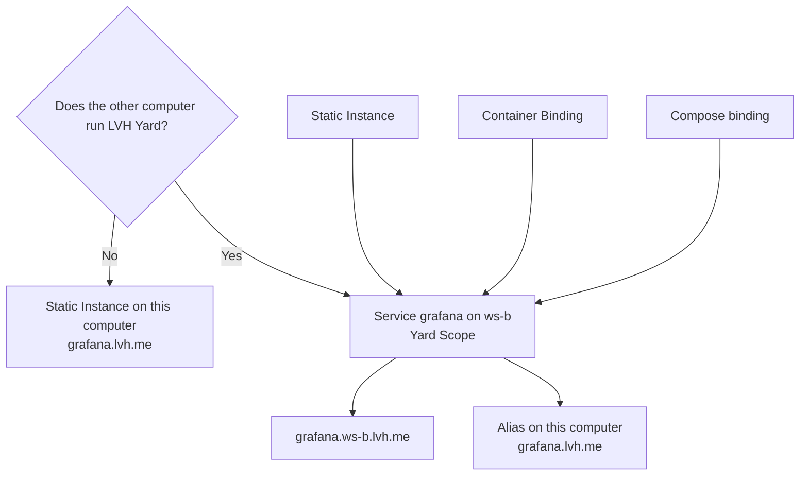

# Reach a service on another computer

"A service runs on another computer in my LAN, and I want to open it by name."

You open the service from this computer at a hostname. The steps depend on what
runs on the other computer.



## Before you start

You need:

- A running Workstation on this computer. `lvh-yard status` starts with
  `LVH Yard on this Workstation: ok`.
- A Base Domain. See
  [Pick your Base Domain](../../start/pick-your-base-domain.md). Each
  Workstation picks its own. The examples use `lvh.me`.
- A Service with an Instance. The examples use `grafana`. A Static Instance or
  a Container Binding gives it an Instance, as in
  [Your first Service](../../start/first-service.md). A Compose binding does
  too, as in [Stop chasing Compose ports](../name/compose-ports.md).
- If the other computer runs LVH Yard, a Yard that both Workstations joined.
  See [Create a Yard and join it](create-a-yard.md).

## CLI Steps

### The other computer runs LVH Yard

This computer is `ws-a`. The other computer is `ws-b`.

1. Publish the Service with Yard Scope. Yard Scope lets every Workstation of
   the Yard open it. { .ws-b }

    ```sh
    lvh-yard publish grafana --scope yard
    ```

    ```text
    Published grafana at grafana.lvh.me.
      Scope: Yard
      Other Workstations: grafana.ws-b.<base-domain>
    ```

2. Open the hostname of `ws-b`, `grafana.ws-b.<Base Domain>`, in your browser:
   `http://grafana.ws-b.lvh.me`. { .ws-a }

3. To open the Service at the name `grafana` too, add an Alias to it. The Alias
   creates the Service `grafana` with Local Scope. { .ws-a }

    ```sh
    lvh-yard alias add grafana --workstation ws-b --service grafana
    ```

    Open `http://grafana.lvh.me` in your browser.

### The other computer does not run LVH Yard

A NAS or a Raspberry Pi has no Workstation. Register its address as a Static
Instance on this computer. Give the address of the computer with `--host`.

```sh
lvh-yard service create grafana
lvh-yard register static grafana --host 192.168.1.67 --port 3030
lvh-yard publish grafana
```

Open `http://grafana.lvh.me` in your browser.
[Name every HomeLab service](../name/homelab-services.md) has the checks of a
Static Instance.

## Dashboard Steps

- On the other computer, open `http://yard.<Base Domain>` or
  [`http://127.0.0.1:7780`](http://127.0.0.1:7780).
- Open the Service in `Catalog`.
- Switch `Share with the Yard` on.
- On this computer, open the Remote Service in `Catalog` and click `Alias`.
- On this computer, `Add Static Instance` on the page of a Service registers a
  computer with no LVH Yard.
- Follow the forms.

## Check

On this computer, list the Services of every Workstation:

```sh
lvh-yard catalog
```

```text
ws-a (this Workstation)
  consul-ui      healthy  local  consul-ui.lvh.me      1/1  [static]
  traefik-admin  healthy  local  traefik-admin.lvh.me  1/1  [static]
  yard           healthy  local  yard.lvh.me           1/1  [static]
ws-b
  grafana        healthy  yard   grafana.ws-b.lvh.me   1/1  [docker]
```

`lvh-yard test grafana --workstation ws-b` tests each Instance and the Route,
and names what fails.

## Undo

### Stop sharing the Service

On this computer, delete the Service that holds the Alias or the Static
Instance. On the other computer, take the Service back to Local Scope.

```sh
lvh-yard service delete grafana
lvh-yard publish grafana --scope local
```

## Troubleshooting

### `Workstation unreachable`

`lvh-yard catalog` shows the other Workstation with no Services:

```text
ws-b: Workstation unreachable
To see why, run:
  lvh-yard ws compose logs consul
```

The other computer is off, or its Consul stopped, or a firewall blocks the
ports of the Yard. See `Consul cannot read from ws-b` in
[Create a Yard and join it](create-a-yard.md#consul-cannot-read-from-ws-b).

### `risk: [Loopback Instances]`

`lvh-yard publish` prints a risk, and the other computers do not open the
Service:

```text
risk: [Loopback Instances] 127.0.0.1:3030 is on loopback. Other Workstations cannot reach it. Register it at the LAN address.
```

An Instance on `127.0.0.1` is open on its own computer only. Other Workstations
give an Instance on loopback no Route. Make the program listen on every
address. Register it at the LAN address of its computer:

```sh
lvh-yard remove grafana --port 3030
lvh-yard register static grafana --host 192.168.1.67 --port 3030
```
