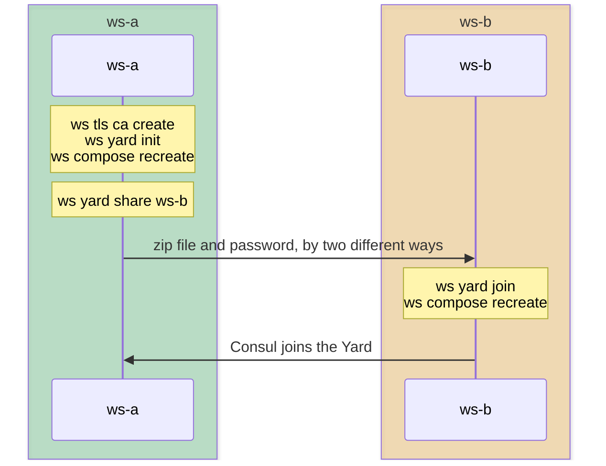

# Create a Yard and join it

"Each of my computers sees only its own Services."

`ws-b` joins the Yard of `ws-a`. Then each Workstation lists the Services of
the other.



## Before you start

You need:

- A running Workstation on each computer, made as in
  [Install LVH Yard](../../start/install.md). `lvh-yard status` starts with
  `LVH Yard on this Workstation: ok`.
- A name for each Workstation. The examples use `ws-a` and `ws-b`. You gave the
  name to `ws init`.
- A firewall that lets the two computers reach each other on TCP 8300 and on
  TCP and UDP 8302. These are the default ports. `lvh-yard ws yard init` prints
  the ports of your Workstation.

Each Workstation keeps its own Base Domain.

## CLI Steps

`ws-a` starts the Yard and holds its CA. `ws-b` joins it.

1.  **ws-a**{.ws-a} Make the Workstation CA. It signs the certificates of the Yard.

    ```sh
    lvh-yard ws tls ca create
    ```

2.  **ws-a**{.ws-a} Open the Workstation to a Yard. Run it once. It prints the ports to allow in the firewall.

    ```sh
    lvh-yard ws yard init
    ```

3.  **ws-a**{.ws-a} Apply the change.

    ```sh
    lvh-yard ws compose recreate
    ```

4.  **ws-a**{.ws-a} Write the invitation for `ws-b`. `ws-b` is the name that you gave to `ws init` on the other computer.

    !!! warning "The zip file and its password open your Yard"

        Whoever has the zip file and its password can join your Yard. Send them by two different ways. Never send `ca.key`. Delete the zip file when `ws-b` has joined.

    ```sh
    lvh-yard ws yard share ws-b
    ```

    ```text
    Zip password: NpKmBTVmtEJzMo0sK8cY-9FoNtdvUD3C
      Save it now. It is not shown again.
    ```

5.  **ws-b**{.ws-b} Read the invitation. The command asks for the password.

    ```sh
    lvh-yard ws yard join ws-b-yard.zip
    ```

6.  **ws-b**{.ws-b} Apply the change.

    ```sh
    lvh-yard ws compose recreate
    ```

## Dashboard Steps

- The dashboard has no form to join a Yard. Use the CLI Steps.

## Check

On both computers, read the status:

```sh
lvh-yard status
```

```text
LVH Yard on this Workstation: ok
  ok    Consul: Consul has a leader, and 2 Workstations are in its WAN pool.
```

## Undo

On the computer that leaves the Yard, run `lvh-yard ws yard standalone`. It
prints the `compose recreate` command to run.

```sh
lvh-yard ws yard standalone
lvh-yard ws compose recreate
```

## Troubleshooting

### `Consul cannot read from ws-b`

The status of `ws-a` shows a warning:

```text
LVH Yard on this Workstation: warning
  WARN  Consul: Consul cannot read from ws-b, though its WAN pool lists it as alive.
```

`ws-b` is off, or its Consul stopped, or a firewall blocks the ports of the
Yard. Start it. Allow TCP 8300 and TCP and UDP 8302 between the two computers,
in both directions, for the Yard's computers only. Then read the log of Consul:

```sh
lvh-yard ws compose logs consul
```

### `this Invitation is for ws-b, and this Workstation is ws-c`

`lvh-yard ws yard join` refuses the zip file. The invitation names one
Workstation. The name that you gave to `share` is not the name of the
Workstation that reads it:

```text
this Invitation is for ws-b, and this Workstation is ws-c. Ask the sender for an Invitation for ws-c
```

**ws-a**{.ws-a} Run `lvh-yard ws yard share ws-c`. Send the new zip file and its new password.
