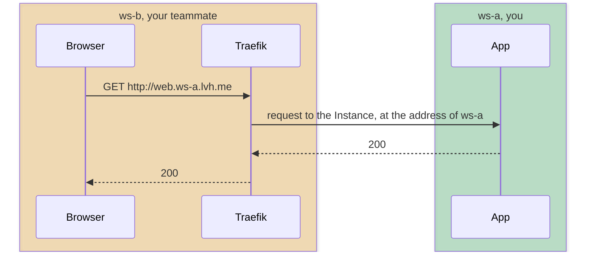

# Show your work to a teammate

"My teammate cannot open my service."

A teammate opens it at `http://web.ws-a.lvh.me`.



## Before you start

You need:

- A Yard that your teammate's Workstation joined. See
  [Create a Yard and join it](create-a-yard.md). The examples use `ws-a` for
  you and `ws-b` for your teammate.
- A Base Domain on each Workstation. See
  [Pick your Base Domain](../../start/pick-your-base-domain.md). The examples
  use `lvh.me`.
- An app that listens on every address of your computer. An app that listens on
  `127.0.0.1` refuses other computers.

## CLI Steps

1. **ws-a**{.ws-a} Run the app on every address. The example is a static file server.

    ```sh
    python3 -m http.server 4000 --bind 0.0.0.0
    ```

2. **ws-a**{.ws-a} Give the app a Service and an Instance. Without `--host`, the Instance is at the address of your Workstation, its LAN address in a Yard.

    ```sh
    lvh-yard service create web
    lvh-yard register static web --port 4000
    ```

3. **ws-a**{.ws-a} Publish the Service with Yard Scope.

    !!! warning "Yard Scope gives a hostname, not a lock"

        Yard Scope gives every Workstation of the Yard a hostname for the Service. It does not decide who can connect. A program that listens on every address accepts every computer of the network, with or without the hostname. Use it on a network that you trust.

    ```sh
    lvh-yard publish web --scope yard
    ```

    ```text
    Published web at web.lvh.me.
      Scope: Yard
      Other Workstations: web.ws-a.<base-domain>
    ```

4. **ws-b**{.ws-b} Open `web.ws-a.<Base Domain>`, with the Base Domain of your teammate's Workstation. Here it is `http://web.ws-a.lvh.me`.

## Dashboard Steps

- **ws-a**{.ws-a} Open `http://yard.<Base Domain>` or [`http://127.0.0.1:7780`](http://127.0.0.1:7780).
    - Open the Service in `Catalog`.
    - Switch `Share with the Yard` on.
- **ws-b**{.ws-b} Find the Service under `ws-a` in `Catalog`, and click its hostname.
    - Follow the forms.

## Check

**ws-b**{.ws-b} Test the Service of `ws-a`:

```sh
lvh-yard test web --workstation ws-a
```

```text
Reachability of web on ws-a, from this Workstation:
  ok    Instance 192.168.1.67:4000 (in the Route)
  ok    Route http://web.ws-a.lvh.me: answered 200
```

## Undo

**ws-a**{.ws-a} Take the Service back to Local Scope, or delete it:

```sh
lvh-yard publish web --scope local
lvh-yard service delete web
```

## Troubleshooting

### `Connection refused`

The teammate gets `502 Bad Gateway`. `lvh-yard test web --workstation ws-a`
names the cause:

```text
Reachability of web on ws-a, from this Workstation:
  FAIL  Instance 192.168.1.67:4000 (in the Route): Connection refused (connect failed)
  FAIL  Route http://web.ws-a.lvh.me: Traefik answered 502: no Instance answered.
No Instance passes. The Route uses every Instance in range.
2 of 2 checks failed.
```

The app listens on `127.0.0.1`, and the Instance is at the LAN address of
`ws-a`. Run the app on every address, as in step 1.

### `404 page not found`

The teammate opens `http://web.lvh.me`, and Traefik answers
`404 page not found`:

```text
404 page not found
```

The hostname has no Workstation name, so it is a hostname of the teammate's own
Workstation. Open `http://web.ws-a.lvh.me`.

### `Workstation unreachable`

`lvh-yard catalog` shows `ws-a: Workstation unreachable`. See
`Consul cannot read from ws-b` in
[Create a Yard and join it](create-a-yard.md#consul-cannot-read-from-ws-b).
