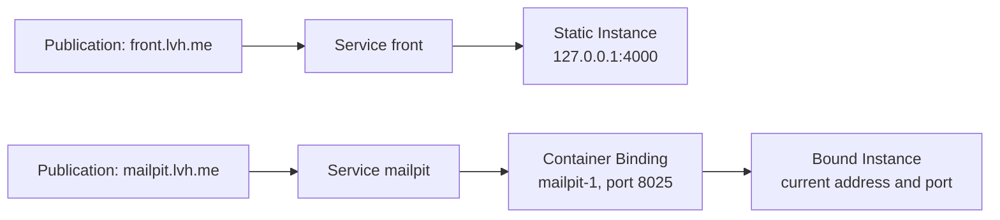

# Your first Service

A dev server listens on a port, and you must remember that port to open it. A
Service gives the process a name instead. You create the Service, register the
host and port of the process as a Static Instance, and publish it. Then the
process has the hostname `http://front.<Base Domain>`, whatever its port.

A Docker container has a second problem. Docker gives it a new host port each
time it starts, so an address that you wrote down goes stale. A Service can
follow the container instead. A Container Binding links the Service to the
container by its name and its container port. LVH Yard follows the container, so
the hostname stays the same when the host port changes.

## Before you start

You need three things:

- A running Workstation. `lvh-yard status` starts with
  `LVH Yard on this Workstation: ok`.
- A Base Domain. See [Pick your Base Domain](pick-your-base-domain.md). The
  examples use `lvh.me`.
- An app that listens on a port. The examples use a dev server on port 4000 and
  the `axllent/mailpit` container, which listens on port 8025.

## What you create

A Service is a name, such as `front`. An Instance is one running copy of the
Service, at a host and a port. A Publication gives the Service a hostname.
Traefik sends the requests for that hostname to the Instances of the Service
that pass their health checks.



## Publish a process

Create the Service. It is empty and unpublished until you add an Instance and
publish it. The command also lists one command for each kind of Instance. A
process is a Static Instance.

```sh
lvh-yard service create front
```

Add a Static Instance. It is the host and port where your app listens. Most dev
servers listen on localhost only, so give `--host 127.0.0.1`.

Without `--host`, LVH Yard registers the address of your Workstation. That is
`127.0.0.1` on a new Workstation, and its LAN address once the Workstation
starts or joins a Yard. An app that listens only on `127.0.0.1` refuses the
connection at the LAN address. See [Connection refused](#connection-refused).

```sh
lvh-yard register static front --host 127.0.0.1 --port 4000
```

Publish the Service and open it. Traefik needs a few seconds to pick up a new
Route.

```sh
lvh-yard publish front
curl http://front.lvh.me
```

Or open `http://front.lvh.me` in your browser.

`lvh-yard publish` prints the hostname and the State of the Service. The State
is `unhealthy` until the first health check passes. The default check connects
to the port every 10 seconds.

## Publish a container

Start the container. Docker publishes its port 8025 on a port that Docker
chooses.

```sh
docker run -d --name mailpit-1 -p 8025 axllent/mailpit
```

Create a second Service and bind it to the container by name and container
port. The Container Binding follows the container, so you never give the host
port.

```sh
lvh-yard service create mailpit
lvh-yard register container mailpit-1 --port 8025 --service mailpit
lvh-yard publish mailpit
```

`http://mailpit.lvh.me` now opens Mailpit. When you remove the container and
start it again, Docker chooses another port. The Container Binding follows the
new port, and the hostname does not change.

## Read the catalog

`lvh-yard catalog` lists the Services of the Yard, grouped by Workstation:

```sh
lvh-yard catalog
```

```text
ws-a (this Workstation)
  consul-ui      healthy  local  consul-ui.lvh.me      1/1  [static]
  front          healthy  local  front.lvh.me          1/1  [static]
  mailpit        healthy  local  mailpit.lvh.me        1/1  [docker]
  traefik-admin  healthy  local  traefik-admin.lvh.me  1/1  [static]
  yard           healthy  local  yard.lvh.me           1/1  [static]
```

LVH Yard registers `consul-ui`, `traefik-admin` and `yard` (the dashboard) when
it starts for the first time. See
[The default Services](install.md#the-default-services).

## Dashboard Steps

- Open `http://yard.<Base Domain>` or [`http://127.0.0.1:7780`](http://127.0.0.1:7780).
- `Catalog` lists your Services. `New Service` creates one.
- On the page of a Service, `Add Static Instance` registers a process, `Bind container` follows a container, and the `Published` switch publishes it.
- `Containers` lists your containers, with a `Create Service` button for each port.
- Follow the forms.

## Undo

`lvh-yard unpublish` removes the hostname and keeps the Instances.
`lvh-yard remove` removes one Instance or Container Binding.
`lvh-yard service delete` removes the Service with its Publication, Static
Instances and Container Bindings. It leaves the containers running.

```sh
lvh-yard unpublish front
lvh-yard remove front --port 4000
lvh-yard remove mailpit --container mailpit-1
lvh-yard service delete front
lvh-yard service delete mailpit
```

## Troubleshooting

### Connection refused

The catalog shows the Service as `unhealthy` with `0/1` Instances, and the
hostname answers `502 Bad Gateway`. `lvh-yard test front` names the cause:

```text
Reachability of front on ws-a, from this Workstation:
  FAIL  Instance 192.168.1.67:4000 (in the Route): Connection refused (connect failed)
  FAIL  Route http://front.lvh.me: Traefik answered 502: no Instance answered.
No Instance passes. The Route uses every Instance in range.
2 of 2 checks failed.
```

The app listens on `127.0.0.1`, and the Instance is at the LAN address of the
Workstation (`192.168.1.67` here). A Workstation in a Yard registers its LAN
address when you give no `--host`. Remove the Instance and register it again
with `--host 127.0.0.1`. Or make the app listen on every address.

### 404 page not found

Traefik answers `404 page not found` when it has no Route for the hostname. The
Service has no Publication, or the hostname uses another Base Domain.
`lvh-yard catalog` shows the hostname of each published Service. Publish the
Service with `lvh-yard publish front`.
