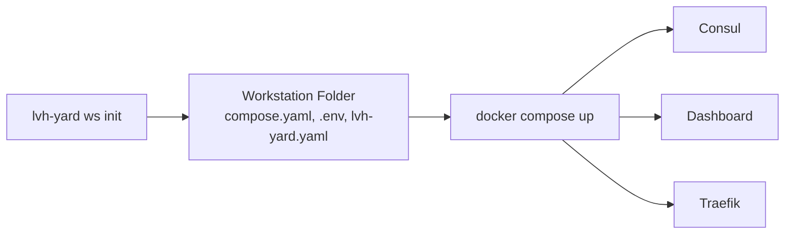

# Install LVH Yard

Install the `lvh-yard` executable. Create a Workstation with
`lvh-yard ws init`, start it with Docker Compose, and check it with
`lvh-yard status`. Each step is one command. The Workstation then serves its
dashboard at [`http://127.0.0.1:7780`](http://127.0.0.1:7780).

## Before you start

You need:

- Docker with Compose on every computer that runs a Workstation. Docker is the
  only supported container runtime. Podman is not supported.
- Linux (amd64 or arm64), macOS (arm64) or Windows 11 (x64). The executable
  needs no Java.
- On Windows, Docker Desktop 4.34 or later, with Linux containers and the WSL2
  backend. Turn host networking on and Enhanced Container Isolation off. The
  Windows Workstation supports IPv4 only. The executable is not signed, so
  Windows can warn about an unknown publisher.

## What the steps create



`lvh-yard ws init` writes the files into the Workstation Folder. Docker Compose
reads them and starts three containers: Consul, the dashboard and Traefik.
Consul keeps its data in a Docker volume, not in the folder.

## Install the executable

=== "Linux and macOS"

    ```sh
    curl -fsSL https://lvhy.cc/install.sh | sh
    ```

    The script downloads the archive of your platform and checks it against `SHA256SUMS`. It then copies `lvh-yard` to `~/.local/bin`. As root, it copies it to `/usr/local/bin`. If that folder is not on your `PATH`, the script prints the line to add.

=== "Windows"

    Read the installer before you run it. Use Windows PowerShell 5.1 or PowerShell 7:

    ```powershell
    $installer = Invoke-RestMethod https://lvhy.cc/install.ps1
    $installer
    Invoke-Expression $installer
    ```

    To run it without reading it first, use the short form. `irm` and `iex` are the default aliases of `Invoke-RestMethod` and `Invoke-Expression`:

    ```powershell
    irm https://lvhy.cc/install.ps1 | iex
    ```

    The installer needs no administrator rights. It copies `lvh-yard.exe` to `$env:LOCALAPPDATA\lvh-yard\bin` and adds that folder to your user `PATH`. Open a new terminal afterwards.

Check the executable:

```sh
lvh-yard --version
```

Set `LVH_YARD_VERSION` to install a release other than the latest one.

## Create the Workstation

```sh
lvh-yard ws init
```

The command asks for the name of this Workstation and for its Base Domain.
Press Enter at the first question to use the hostname of this computer. The
Base Domain has no default. See
[Pick your Base Domain](pick-your-base-domain.md). To skip the questions, give
both as flags:

```sh
lvh-yard ws init --workstation ws-a --base-domain dev.example.com
```

The Workstation Folder is `~/.config/lvh-yard` on Linux and macOS. On Windows
it is `$env:LOCALAPPDATA\lvh-yard\workstation`. `--dir` picks another folder
for any `ws` command.

## Start and check the Workstation

!!! warning "The dashboard has no login"

    Anyone who reaches the dashboard can change the Services of that Workstation. They can also reach its containers through the Docker socket. By default the dashboard listens on `127.0.0.1` only. Read [SECURITY.md](https://github.com/ppalazon/lvh-yard/blob/main/SECURITY.md) before you open it to your LAN.

=== "Linux and macOS"

    ```sh
    lvh-yard ws compose start
    ```

=== "Windows"

    ```powershell
    Set-Location -LiteralPath "$env:LOCALAPPDATA\lvh-yard\workstation"
    docker compose up -d
    ```

Then check the Workstation:

```sh
lvh-yard status
```

The first line of the status is `LVH Yard on this Workstation: ok`. Open the
dashboard at [`http://127.0.0.1:7780`](http://127.0.0.1:7780). You can also
open it at `http://yard.<Base Domain>` when the Base Domain resolves to
`127.0.0.1`.

## The default Services

The first time the dashboard starts, it registers three Services with Local
Scope. Each one has a Static Instance on `127.0.0.1`. You reach the pages of
LVH Yard by name, with no port to remember. Open them at their hostnames below
your Base Domain. If you changed `http-port`, add the port to the address.

| Service         | Address                              | Its Static Instance points to |
| --------------- | ------------------------------------ | ----------------------------- |
| `yard`          | `http://yard.<Base Domain>`          | 127.0.0.1:7780                |
| `consul-ui`     | `http://consul-ui.<Base Domain>`     | 127.0.0.1:8500                |
| `traefik-admin` | `http://traefik-admin.<Base Domain>` | 127.0.0.1:8080                |

The Instances use the ports that `.env` holds at the first start. The defaults
are the ports in the table. The dashboard sets the Services up once. After
that, they are ordinary Services. You can change, unpublish or delete them, and
they do not come back. The dashboard is also always at `127.0.0.1:7780`, even
when Traefik is down or you unpublish `yard`.

## `LVH Yard on this Workstation: failing`

`lvh-yard status` lists Consul, Traefik and Docker, each with `ok` or `FAIL`
and a reason. The command exits with 1 when a part fails. With Traefik stopped,
for example, the status says that Traefik does not answer its ping and that you
must make sure that it runs.

`lvh-yard ws compose logs consul`, `lvh-yard ws compose logs traefik` and
`lvh-yard ws compose logs dashboard` show the log of one service.
`lvh-yard ws compose restart` restarts all three.
