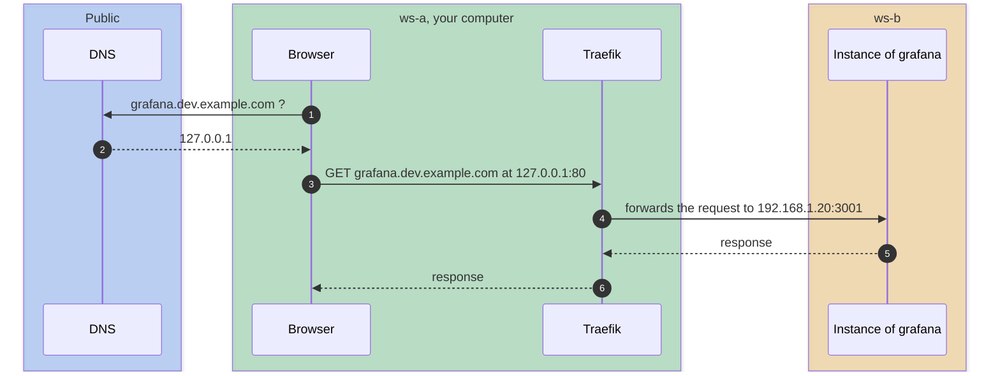

# Pick your Base Domain

The Base Domain is how you open a published Service by name. A Service named
`front` has the hostname `front.<Base Domain>`, and Traefik reads that hostname
in each request to know which Service you want.

For development, LVH Yard uses a wildcard DNS as Base Domain that points to
`127.0.0.1`. So you reach every Service, local or remote, through `localhost`,
which is your own computer.

`lvh-yard ws init` asks for the Base Domain and has no default. To try LVH
Yard, a shared domain such as `l.lvhy.cc` or `lvh.me` is enough, and you don't
have to configure any DNS entry. The problem is that the owner of a shared
domain can change its DNS answer at any time. **So, for daily work, use a
wildcard domain that you control.**

## How the wildcard DNS works

Every Route has a rule such as ``Host(`grafana.dev.example.com`)``, which LVH
Yard builds from the Base Domain. It asks DNS for the hostname, and DNS must
answer with the address where Traefik listens.

LVH Yard does not edit `/etc/hosts` and does not publish DNS records. You give
it a domain whose DNS already answers correctly.

The correct answer is `127.0.0.1`. Traefik on your Workstation listens on
`127.0.0.1` by default, and every Route lives on your own Traefik, also the
Routes for Services of other Workstations. A hosts file cannot do this, because
it has no wildcards and needs one line for each hostname on each computer. If
you move Traefik off loopback, the answer must change with it.



The diagram follows one request from your computer, `ws-a`. `grafana` is a
Service of `ws-a`, and its Instance runs on `ws-b` at the invented address
`192.168.1.20:3001`. The browser gets `127.0.0.1` from DNS and connects to
Traefik on port 80. It sends the hostname with the request. Traefik matches the
hostname to the Route of `grafana` and forwards the request to the Instance. An
Instance on `ws-a` itself takes the same path.

The wildcard must match names with several labels, because a service in any
other Workstation hostname has the form
`<service>.<workstation>.<Base Domain>`. A DNS wildcard enables this
possibility ([RFC 4592](https://www.rfc-editor.org/rfc/rfc4592)).

Each Workstation has its own Base Domain, that can be different. A hostname
uses the Base Domain of the Workstation that opens it. Take `wiki`, a Service
of `ws-b` with Yard Scope. If `ws-a` uses `lvh.me` and `ws-b` uses
`dev.localhost`, the hostname is `wiki.dev.localhost` on `ws-b` and
`wiki.ws-b.lvh.me` on `ws-a`.

## Options

| Option                             | Example               | Works offline | Who controls the answer | Use for      |
| ---------------------------------- | --------------------- | ------------- | ----------------------- | ------------ |
| 1. Your own wildcard domain        | `dev.example.com`     | No            | You                     | Daily work   |
| 2. A wildcard in your own resolver | `lab.home`            | Yes           | You                     | Daily work   |
| 3. A shared domain                 | `l.lvhy.cc`, `lvh.me` | No            | Someone else            | Trials       |
| 4. `dev.localhost`                 | `dev.localhost`       | Yes           | Nobody: it needs no DNS | Offline work |

### Your own wildcard domain

At the register of a domain that you own, add one wildcard record:

```text
*.dev.example.com.   300   IN   A   127.0.0.1
```

Set the Base Domain to `dev.example.com`. Nobody else can change or remove the
record, so this option suits daily work.

The lookup goes to public DNS, so it fails offline. Some routers also drop
public answers that point to `127.0.0.1`. See
[Could not resolve host](#could-not-resolve-host).

### A wildcard in your own resolver

A DNS server that you run can hold the same rule. In dnsmasq, one line does it:

```text
address=/lab.home/127.0.0.1
```

Set the Base Domain to `lab.home`. The resolver answers locally, so the rule
works offline. It also works on a router that blocks loopback answers from
public DNS. Every computer that opens these hostnames must use that resolver.

### A shared domain

`l.lvhy.cc` is the domain of this project. It exists for LVH Yard, and the
project examples use it. `lvh.me` belongs to a third party. Both answer
`127.0.0.1` for every name below them, with no setup.

Use either one for the first five minutes and for trials.

!!! warning "A shared domain can change or disappear at any time"

    The owner of `lvh.me` or of `l.lvhy.cc` controls its DNS. The owner can point the names to another address, or remove them. If that happens, your browser sends the requests for your Services to that address. Plain HTTP requests carry your cookies and your basic-auth passwords. If the names disappear, every Route stops working until you change the Base Domain.

    Always use HTTPS, with a certificate that your Workstation CA signs and your browser trusts (`lvh-yard ws tls https create`). Your browser then refuses an address that cannot show that certificate, and it sends no cookie or password to it. The owner of a shared domain can still get a certificate for these names from a public CA, so HTTPS does not protect you from the owner. For daily work, use a domain that you control.

### `dev.localhost`

Every name that ends in `.localhost` points to your own computer, and no DNS
server takes part. Chromium and the resolver of Linux resolve these names
themselves.

Use `dev.localhost`, not `localhost` alone. A Base Domain with one label gets
an HTTPS certificate for `*.localhost`. Browsers and `curl` reject a wildcard
that has only one label after the star. The certificate for `dev.localhost`
names `*.dev.localhost`, and they accept it.

Keep in mind that, the name could resolve to `::1` first, and Traefik listens
on `127.0.0.1`. `curl` tries `::1`, gets "Connection refused", and then
connects to `127.0.0.1`. A program that stops after the first address cannot
connect.

!!! warning "Names that point to localhost can have issues with integrations"

    An OAuth service sends your browser back to a callback URL that you register. Some services refuse a callback URL that points to your own computer, or one that does not use HTTPS. A service that calls your URL from its own servers cannot reach it, because the name points to the computer of the service. For these cases, use HTTPS and a domain that you control, and check the rules of the service.

    For HTTPS, pick a Base Domain with at least two labels, such as `dev.localhost` or `lvh.me`. Browsers and `curl` reject the certificate of a Base Domain with one label, such as `localhost`.

## Set the Base Domain

Look up two names below the domain before you enter it. Then give the domain to
`lvh-yard ws init`.

### Look up the domain

Test the domain before you enter it. Look up `anything.l.lvhy.cc`, a name with
one label below the domain, and `a.b.l.lvhy.cc`, a name with two labels. Use
your own domain in place of `l.lvhy.cc`. The second name matters because a Yard
hostname has two labels below the Base Domain. LVH Yard does not test the
domain for you: `lvh-yard status` checks only Consul, Traefik and Docker.

=== "Linux"

    ```sh
    getent hosts anything.l.lvhy.cc
    getent hosts a.b.l.lvhy.cc
    ```

=== "Any system"

    ```sh
    nslookup anything.l.lvhy.cc
    ```

Both names must resolve to `127.0.0.1`. On Linux, the output looks like this:

```text
127.0.0.1       anything.l.lvhy.cc
127.0.0.1       a.b.l.lvhy.cc
```

### Enter the domain

`lvh-yard ws init` asks for the domain at its last prompt:

```text
The Base Domain ends every hostname that this Workstation routes, such as web.<Base Domain>.
Use a wildcard domain that resolves every name to 127.0.0.1, such as "lvh.me" or "l.lvhy.cc".
If you are offline, or your router blocks such answers, use localhost.
Base Domain:
```

The prompt suggests `localhost` for offline work. Enter `dev.localhost`
instead, so that HTTPS works.

Without a terminal, give the flag `--base-domain`:

```sh
lvh-yard ws init --workstation ws-a --base-domain dev.example.com
```

## Change the Base Domain

`lvh-yard ws set` saves the new value in `.env` and restarts nothing. To apply
the value, recreate the containers:

```sh
lvh-yard ws set base-domain dev.example.com
lvh-yard ws compose recreate
```

```text
Saved .env.
Next:
  lvh-yard ws compose recreate
```

After the containers restart, every Route has its new hostname. Traefik answers
`404 page not found` for the old ones.

```text
$ lvh-yard catalog
ws-a (this Workstation)
  consul-ui      healthy  local  consul-ui.dev.example.com      1/1  [static]
  front          healthy  local  front.dev.example.com          1/1  [static]
  traefik-admin  healthy  local  traefik-admin.dev.example.com  1/1  [static]
  yard           healthy  local  yard.dev.example.com           1/1  [static]
ws-b
  grafana        healthy  yard   grafana.ws-b.dev.example.com   1/1  [static]
```

To undo the change, run the same two commands with the old domain. An HTTPS
certificate that you created earlier names the old Base Domain.

## Could not resolve host

`curl` prints this error, and the browser says that it cannot find the server:

```text
curl: (6) Could not resolve host: front.l.lvhy.cc
```

A router or DNS server can cause this. Some of them drop a public answer that
points to `127.0.0.1`, to stop DNS rebinding attacks. dnsmasq does this with
`stop-dns-rebind`. It gives no answer for names such as `a.lvh.me`, and it logs
`possible DNS-rebind attack detected`. Other routers and DNS servers can have a
similar setting.

Three changes fix it:

- Use a wildcard in your own resolver. The rule `address=/lab.home/127.0.0.1`
  still answers with `stop-dns-rebind`.
- Allow the domain in the resolver. In dnsmasq, add
  `rebind-domain-ok=/l.lvhy.cc/`.
- Use `dev.localhost`.
