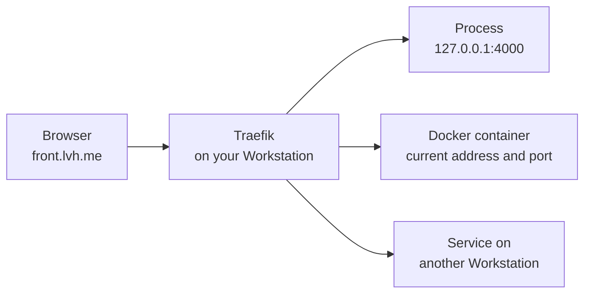

# What LVH Yard solves

LVH Yard gives each development service a hostname such as
`http://grafana.lvh.me`. The hostname works on your computer and on every other
computer in your Yard. You stop remembering ports and editing `/etc/hosts`. A
Service has a name. Traefik routes the hostname to the process or container
behind it. A wildcard DNS makes the hostname reach Traefik.

To try it, [install LVH Yard](install.md).

## Problems it removes

- "I forget which port each service uses." A Service has a name, and its
  hostname replaces the port. See [Your first Service](first-service.md).
- "Docker gives my container a new port after every `compose up`." A Container
  Binding follows the container, so the hostname stays the same when the port
  changes. See [Your first Service](first-service.md).
- "I edit `/etc/hosts` on each computer, and I do it again for the next one." A
  wildcard DNS answers for every hostname, so no computer needs a hosts file.
  See [Pick your Base Domain](pick-your-base-domain.md).
- "`localhost:3000` breaks my cookies and my OAuth callbacks." Each Service has
  its own hostname. Cookies ignore the port
  ([RFC 6265](https://www.rfc-editor.org/rfc/rfc6265#section-8.5)), so two
  services on `localhost` share them. Two hostnames keep their cookies apart by
  default. Some OAuth services refuse a callback URL that points to your own
  computer. The warning in [Pick your Base Domain](pick-your-base-domain.md)
  lists the cases to check.
- "I need HTTPS in development, and I do not want to click through warnings."
  The Workstation CA signs the HTTPS certificate of your Workstation. Your
  browser shows no warning once it trusts that CA.
- "My teammate cannot open my service." With Yard Scope, every Workstation of
  the Yard opens your Service at `<service>.<workstation>.<Base Domain>`.

## The path of a request

Traefik reads the hostname of each request. It sends the request to an Instance
of that Service. The Instance is a process at a host and a port, a Docker
container that LVH Yard follows, or an Instance of a Service on another
Workstation. [Pick your Base Domain](pick-your-base-domain.md) explains how the
hostname reaches Traefik.

## What LVH Yard does not do

- It does not start or stop your processes. It manages Services, not the
  processes behind them.
- It is not a DNS server, and it does not edit `/etc/hosts`. The Base Domain
  that you pick gives the DNS answer.
- It is a development tool for a network that you trust. The dashboard has no
  login. A Scope decides who gets a hostname, not who can connect. See
  [SECURITY.md](https://github.com/ppalazon/lvh-yard/blob/main/SECURITY.md).
- It supports Docker as the only container runtime. It does not support Podman.
